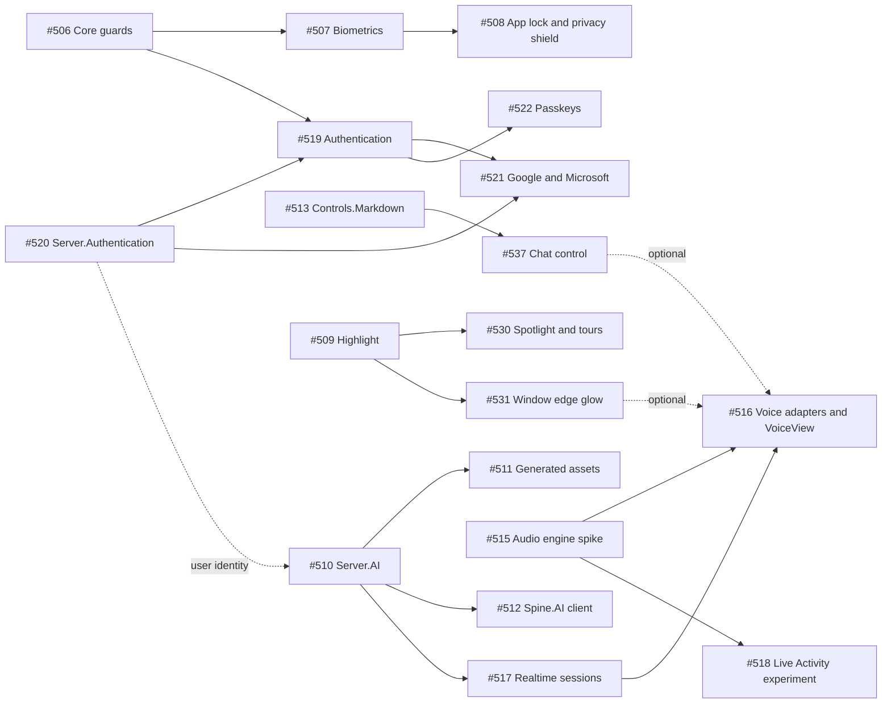

# Implementation plan: AI, voice, sign-in and app security

**Roadmap issue:** [#505](https://github.com/jonatansoderberg/Maui.Spine/issues/505)
**Started:** 2026-10-09
**Last updated:** 2026-10-12 (step 2.5a `Controls.Markdown` merged as #538; 2.5b `Controls.Chat` in review as #539; see Verification backlog)

This is the living plan for the work that came out of the AI and security brainstorm on 2026-10-09. A new session should be able to pick up from here, so every pull request that moves a step forward updates this file in the same PR.

---

## How to continue from a new session

1. Read this file, then the proposal for the step you take.
2. Check the live state of the issues. This file can lag behind GitHub, and GitHub wins:
   `gh issue list --search "505 in:body" --state all --limit 50`
3. Pick the first step in [Steps](#steps) whose status is **Ready**: its dependencies are done and its open questions are answered. If the only steps left have unanswered questions, ask the owner instead of guessing.
4. Work in a git worktree off `origin/master`. Several sessions share the main checkout, so never run `git checkout` there:
   `git fetch origin master && git worktree add ../Maui.Spine-<id> -b issue/<id>-<slug> origin/master`
5. Start the issue with the `/spine-issue <id>` workflow from `CLAUDE.md`. The issue changelog lives in `issues/<id>-<slug>.md`.
6. In the same PR:
   - set the step's status, PR and notes in [Steps](#steps)
   - add any decision you made or got to [Decisions](#decisions)
   - update **Last updated** at the top
7. Before a merge, check the files that every feature branch touches. See [Files every package PR touches](#files-every-package-pr-touches).
8. Add whatever you could not verify to the [Verification backlog](#verification-backlog), and remove the entries you did verify.

Status values: **Proposal** (written, not reviewed), **Waiting** (on another step or on an answer), **Ready**, **In progress**, **In review** (PR open), **Done**, **Parked**, **Dropped**.

---

## Principles

- **Spine is a smorgasbord.** An app takes only what it needs. The core gets small generic hooks and nothing else.
- **Every feature is its own NuGet package** and registers itself only when it is referenced (`<SpineModule>`, #355).
- **Heavy native dependencies get their own packages:** MSAL, the Google bindings, ML Kit and a markdown parser.
- **Server parts are separate packages** next to `Plugin.Maui.Spine.Server`, which stays the push backend.
- **No model abstractions of our own.** Microsoft.Extensions.AI (`IChatClient`, `IImageGenerator`, `IRealtimeClient`) is the contract. Spine adds what sits around it: configuration, cost control, UI, audio and platform integration.
- **No provider keys in an app.** Model calls and realtime sessions are set up by the app's server. Sign-in is the exception: it works both with and without a Spine server (Q7).
- **Documentation is in English:** wiki, proposals, READMEs, PR bodies and the `issues/` changelogs. Conversation with the owner is in Swedish.

---

## Package map

| Package | Kind | Issues | Proposal | Status |
|---|---|---|---|---|
| `Plugin.Maui.Spine` (core) | Navigation and command guards | #506 | [guards-biometrics §2](../proposals/spine-guards-biometrics.md) | Done (#526) |
| `Plugin.Maui.Spine.Biometrics` | New | #507, #508 | [guards-biometrics §3–§5](../proposals/spine-guards-biometrics.md) | Done (#527, #529) |
| `Plugin.Maui.Spine.Controls.Highlight` | New | #509, #530, #531 | [highlight](../proposals/spine-highlight.md) | Done (#532, #533, #534) |
| `Plugin.Maui.Spine.Server.AI` | New, server | #510, #511, #517 | [ai §3–§6](../proposals/spine-ai.md), [voice §6](../proposals/spine-voice.md) | #510 done (#535); #511 and #517 Ready |
| `Plugin.Maui.Spine.AI` | New | #512 | [ai §7](../proposals/spine-ai.md) | Done (#536) |
| `Plugin.Maui.Spine.Controls.Markdown` | New (Q21) | #513 | [ai §8](../proposals/spine-ai.md) | Done (#538) |
| `Plugin.Maui.Spine.Controls.Chat` | New | #537 | [ai §8](../proposals/spine-ai.md) | #537 in review (#539) |
| `Plugin.Maui.Spine.Voice` | New | #515, #516, #518 | [voice](../proposals/spine-voice.md) | Proposal |
| `Plugin.Maui.Spine.Authentication` | New | #519 | [authentication](../proposals/spine-authentication.md) | Proposal |
| `Plugin.Maui.Spine.Authentication.Google` / `.Microsoft` | New | #521 | [authentication](../proposals/spine-authentication.md) | Proposal |
| `Plugin.Maui.Spine.Server.Authentication` | New, server | #520 | [authentication](../proposals/spine-authentication.md) | Proposal |
| Passkeys (client and server) | After v1 of sign-in | #522 | [authentication, Passkeys](../proposals/spine-authentication.md) | Waiting |
| AI avatars and character visuals | Separate control library, specified by the owner | — | — | Outside this plan |
| On-device `IChatClient`, Android and Windows | Spike outside the repo | #514 | [ai §9](../proposals/spine-ai.md) | Proposal |

---

## Steps

The order follows value against risk. Steps in different phases can run in parallel when their dependencies allow it. Highlight (#509) and the Markdown view (#513) have no hard dependencies; the chat control (#537) follows #513.

### Phase 0: proposals and issues

| Step | What | Issue | Status | PR | Notes |
|---|---|---|---|---|---|
| 0.1 | Roadmap issue and 17 child issues | #505–#522 | Done | — | Created 2026-10-09 |
| 0.2 | Five proposals and this plan | #505 | Done | #523 | All 31 open questions answered 2026-10-09. |

### Phase 1: guards and biometrics (done 2026-10-12)

| Step | What | Issue | Depends on | Status | PR | Notes |
|---|---|---|---|---|---|---|
| 1.1 | Core navigation guard and command guard | #506 | 0.2 | Done | #526 | Must cover regions, sheets, tabs, `ShowAsync`, shortcuts and deep links. Guarded tabs on Android and Windows show an unlock cover (Q5). |
| 1.2 | `IBiometricAuth`, `[RequiresUnlock]` on pages and commands, `Unlock.Command`, `RequireAsync` | #507 | 1.1 | Done | #527 | |
| 1.3 | App lock (global) and `[PrivacyShield]` (per page) | #508 | 1.2 | Done | #529 | The core gets `SpineOverlay` and `SpineScreen`. |

### Phase 2: AI on the server and in the app

| Step | What | Issue | Depends on | Status | PR | Notes |
|---|---|---|---|---|---|---|
| 2.1 | `Server.AI`: named features, provider plug-and-play, metering, cost, budgets, cache, rate limits | #510 | 0.2 | Done | #535 | Signed-in user from #520 when present, otherwise the installation id with tighter limits (Q19). Azure storage inside the package (Q20). |
| 2.2 | Orientera adopts `Server.AI` for the race story | (Orientera repo) | 2.1 + a Spine release | Waiting | | First real consumer. Done in the Orientera repo after `SpineVersion` is bumped. |
| 2.3 | Generated-asset pipeline | #511 | 2.1 | Ready | | Orientera's arena images are the model, and Almanacka's pictures are a candidate. |
| 2.4 | `Spine.AI` client with on-device fallback | #512 | 2.1 | Done | #536 | The exceptions and `AIOffReason` moved to `.Common`, shared with `Server.AI`; `TaskState` shows "off" as empty through `IEmptyResultException` (Decisions). |
| 2.5a | `Controls.Markdown`: `MarkdownView` on native views | #513 | 0.2 | Done | #538 | Markdown is its own package (Q21). Split from the chat view on 2026-10-12 (Decisions). |
| 2.5b | `Controls.Chat`: the chat view with streaming, composer and tool cards | #537 | 2.5a | In review | #539 | `ChatView` and a separate `ChatComposer` in the page footer (Decisions). Renders answers with `MarkdownView`. |
| 2.6 | On-device `IChatClient` spike, Android and Windows | #514 | none | Ready | | Outside this repo. Contribute upstream to dotnet/maui-labs if it works. |

### Phase 3: highlight (done 2026-10-12)

| Step | What | Issue | Depends on | Status | PR | Notes |
|---|---|---|---|---|---|---|
| 3.1 | `Controls.Highlight`: the package and the per-view kinds Edge, Pulse, Sheen, Trace and Breathe; repeat, keys, `IHighlights` | #509 | 0.2 | Done | #532 | The core gets a public `ReducedMotion` with `Changed`, `Tap.Executed` and `ElementVisuals` (Windows). Shimmer and MeshBackground use the core's `ReducedMotion`. |
| 3.2 | Spotlight and tours: `TourAsync`, `SpineTargets.TryGetFrame` | #530 | 3.1 | Done | #533 | On `SpineOverlay`; `Highlight.Kind="Spotlight"` is a one-step tour. The core gets `SpineTargets`, and `SpineOverlay` on Android draws behind the system bars. |
| 3.3 | The window edge glow: `AttachEdge`, `IEdgeGlow`, `SpineOverlay.Show(…, passTouches)`, iOS corner radii | #531 | 3.1 | Done | #534 | Voice's screen-edge visual uses it. `SpineOverlay.Show(…, passTouches)` in the core; on Android a pass-through overlay is shown again above a later sheet (Decisions). |

### Phase 4: voice

| Step | What | Issue | Depends on | Status | PR | Notes |
|---|---|---|---|---|---|---|
| 4.1 | Audio engine spike: full duplex, echo cancellation, levels and bands | #515 | 0.2 | Ready | | Highest risk. Measure echo on a real iPhone and an Android phone. |
| 4.2 | Realtime session endpoints in `Server.AI` | #517 | 2.1 | Ready | | |
| 4.3 | Provider adapters, `IVoiceSession`, `VoiceView` and visual plug-ins | #516 | 4.1, 4.2 | Waiting | | OpenAI and Azure OpenAI only in v1 (Q28). WebSocket and PCM; WebRTC only if measurements call for it (Q31). Background audio is opt-in (Q26). |
| 4.4 | Live Activity and ongoing-notification experiment | #518 | 4.1 | Waiting | | Decide afterwards whether it ships |

### Phase 5: sign-in

| Step | What | Issue | Depends on | Status | PR | Notes |
|---|---|---|---|---|---|---|
| 5.1 | `Server.Authentication`: ID-token validation, own tokens, refresh rotation | #520 | 0.2 | Ready | | A minimal Azure Tables user store by default, plus `IUserResolver` (Q9). |
| 5.2 | `Authentication` client: Apple, OIDC, email and password, `[RequiresSignIn]`, refreshing handler | #519 | 1.1, 5.1 | Waiting | | Works with and without a Spine server (Q7), registered as `o.AddAuthentication(...)` inside `UseSpine` (Q8). Needs a Windows path that works on .NET 10. |
| 5.3 | `Authentication.Google` and `.Microsoft` | #521 | 5.2 | Waiting | | |
| 5.4 | Passkeys | #522 | 5.2 | Waiting | | Accepted for after v1 (Q12). The sample domain is still open. |

---

## Verification backlog

These are behaviours that are merged but have not been seen working. Take one when the hardware or setup is at hand (a Windows machine, a Mac with Touch ID, a phone), then remove the entry and say in the PR or commit what was seen.

| Step | What has not been verified | What it takes | How |
|---|---|---|---|
| 1.1 (#506) | Guards on Windows at run time: a guarded page, command and tab. The tab should show the guard's cover. | A Windows machine | A scratch app with two `[NavigableTab]` pages, one guarded (see below), plus the Showcase Guards page |
| 1.1 (#506) | Android and Windows tabs fall back to switching back when the guard has **no** `IGuardCover` | Emulator | A guard that implements only `IGuard<T>` on a tab; tap the tab, refuse; the previous tab should come back and the guarded tab's page should never show |
| 1.1 (#506) | A cold start through a shortcut or a search result to a guarded page. The guard should wait for activation and the root page, then ask over the root. | Simulator or phone | Showcase: put a guard on the page a shortcut opens, kill the app, open it from the shortcut |
| 1.2 (#507) | Windows Hello at run time: `UserConsentVerifierInterop` with the window handle, the result mapping, the availability | A Windows machine with Hello (a PIN is enough) | Showcase Biometrics page |
| 1.2 (#507) | Touch ID on a Mac (Mac Catalyst) | A Mac with Touch ID | Showcase Biometrics page on Mac Catalyst |
| 1.2 (#507) | Fingerprint on Android: `BIOMETRIC_WEAK` with an enrolled finger | An emulator with a fingerprint enrolled in Settings (needs a screen lock), then `adb emu finger touch 1` | Scratch tabbed app or Showcase |
| 1.2 (#507) | The lock-out message after too many failed attempts | Simulator: several `notifyutil -p com.apple.BiometricKit_Sim.pearl.nomatch`; Android: repeated wrong fingerprints | Showcase Biometrics page, Unlock button |
| 1.2 (#507) | `WhenUnavailable = Deny` shows its message on a device without a screen lock | Android emulator without a lock | Scratch app with `UseSpineBiometrics(o => o.WhenUnavailable = UnavailablePolicy.Deny)` |
| 1.3 (#508) | Windows at run time: `WDA_EXCLUDEFROMCAPTURE` on a `[PrivacyShield]` page, the app lock after a minimise and after hiding to the tray (the `AppWindow.Changed` watcher), the lock screen's popup over a sheet's popup and its size when the window is resized | A Windows machine with Hello | Showcase Biometrics page: turn on the app lock, open the Statement page, try the Snipping Tool, minimise and restore |
| 1.3 (#508) | Mac Catalyst: the lock screen and Touch ID after a minimise. The minimise itself was seen to count (the clock's stop time set and cleared), but the cover and the prompt were not run, so as not to put a Touch ID prompt on the owner's screen | The owner at a Mac with Touch ID | Showcase on Mac Catalyst, app lock on, minimise and restore |
| 1.3 (#508) | `PrivacyShield(CoverWhileCaptured = true)` on iOS 17 and later: the cover while the screen is recorded or mirrored. `simctl io recordVideo` does not set the scene's capture state | An iPhone | The Statement page, then screen recording from Control Center |
| 1.3 (#508) | Android before API 30: the device credential is an activity of its own, so the app stops during the prompt. The app lock should not lock again after the PIN | An API 28 or 29 emulator with a PIN | Showcase, app lock on, return from the background and unlock with the PIN |
| 1.3 (#508) | A `Relock` page in a sheet: Back on the lock screen closes the sheet (`CanGoBack` is true for a sheet's page) | Simulator | A scratch sheet page with `[RequiresUnlock(…, Relock = true)]` |
| 3.1 (#509) | Windows at run time: every kind on Composition (Edge's turning linear gradient, the drop-shadow glow and halo), `ElementVisuals` with Tap and Highlight on one element, Tap's press fill and Narrator after the move to the shared container, `IsInWindow` while scrolling | A Windows machine | Showcase Highlight page and Rows page |
| 3.1 (#509) | Screen readers: the tip announced when a highlight starts, and the semantic hint while Edge, Trace or Breathe runs | VoiceOver on a phone or the simulator's Accessibility Inspector; TalkBack on the emulator | Showcase Highlight page, Summarise |
| 3.1 (#509) | Android before API 31 and before API 28: the glow and halo through `BlurMaskFilter`, and the ring fallback without blur | An API 28–30 and an API 26 emulator | Showcase Highlight page, Every kind |
| 3.1 (#509) | Mac Catalyst at run time, and the other kinds on an iPhone. Edge over Liquid Glass was seen on the owner's iPhone on 2026-10-12 | The owner's Mac and iPhone | Showcase Highlight page |
| 3.1 (#509) | Android: a look change mid-run without a blink. The recording held only 23 frames (the emulator records on change) | A phone, or `screenrecord` with the emulator idle | Change Intensity on the Every kind page while recording |
| 3.2 (#530) | Windows at run time: a tour over the popup, Escape, the title bar's `PageAction` and the `NavigationView` tab item as targets | A Windows machine | Showcase Highlight page, and the scratch tabbed app from the test recipes |
| 3.2 (#530) | Screen readers during a tour: the card's focus and "Step 2 of 3" announced, and the dim out of the accessible tree | VoiceOver or TalkBack | Showcase Highlight page, Take the tour |
| 3.2 (#530) | A tour while a sheet is open, and one cut short by a sheet opening (`Cancelled`) | Simulator and emulator | A scratch sheet page that runs a tour |
| 3.3 (#531) | The window edge's corners on other iPhones and on iPads: the table holds published radii, checked only on the iPhone 17 simulator (against `simctl io screenshot --mask=black`) | Other simulators or devices | Showcase Highlight page, The window's edge, a masked screenshot |
| 3.3 (#531) | Windows at run time: the edge over the window, `passTouches` on the popup, `CompositionTarget.Rendering` driving the level | A Windows machine | Showcase Highlight page |
| 3.3 (#531) | Once on iOS, after toggling Reduce Motion while the window edge ran, the XAML spotlight of the Highlight page showed though its `IsActive` binding was false. Not reproduced in three tries | Simulator | Highlight page: Model working, Stop, Reduce Motion on, Speaking |
| 2.1 (#510) | The Anthropic adapter: what it fills in `UsageDetails` (cached input, and cache writes in `AdditionalCounts`), streaming usage, and `Reasoning` mapped to its thinking mode. Orientera's `Story__ApiKey` answered 401 on 2026-10-12, so only OpenAI was called | A valid Anthropic key in the push sample server's user secrets (`Ai:Providers:anthropic:ApiKey`) | The sample server's `send.http`, `/sample/summary` with `"feature": "Story"`, then `GET /ai/usage` |
| 2.1 (#510) | Azure Functions on Azure, not only under the local Functions host: SSE through the Azure front end without buffering, `AzureWebJobsStorage` as the usage store, the report | A deployed Functions app (Orientera, step 2.2) | Stream an exposed feature with `curl -N` and check the events arrive one at a time |
| 2.1 (#510) | `AzureTableAIUsageStore` against a real storage account (checked against Azurite only), and response caching over Redis | Orientera's storage account after step 2.2 | Two calls, the report, and a cached repeat |
| 2.5a (#513) | Screen readers cannot open a link inside text: the paragraph's hint lists the links, and the tap is on a span (the owner's v1 choice). Also not heard yet: VoiceOver and TalkBack on headings, task markers and the Copy button | VoiceOver on a phone, TalkBack on the emulator | Showcase Markdown page |
| 2.5a (#513) | Windows and Mac Catalyst at run time (only compiled and built): spans with a background and gestures, the code block's horizontal scroll, the table grid | A Windows machine; the Mac app | Showcase Markdown page |
| 2.5b (#537) | Windows and Mac Catalyst at run time (only compiled and built): the composer's height and centring, the context menu's Copy, the follow and the jump button | A Windows machine; the Mac app | Showcase Chat page |
| 2.5b (#537) | Enter to send on a Mac and Windows: Enter makes a new line in v1, and MAUI's `Editor` does not tell Enter from Shift+Enter | Platform key handling on the editor | Showcase Chat page with a hardware keyboard |
| 2.5b (#537) | Screen readers: "You: …" and "Assistant: …", the one announcement per answer, the thinking state, Send, Stop and the jump button | VoiceOver on a phone, TalkBack on the emulator | Showcase Chat page |
| 2.5b (#537) | `ToolCallTemplate` and `ThinkingTemplate` are not exercised by the Showcase; only the built-in card and shimmer were seen | A sample or app that sets them | A page with a Highlight `Edge` card as thinking |
| 2.5b (#537) | Long histories: the list is not virtualised (the owner's v1 choice). Not measured above a few dozen messages | A conversation of several hundred messages | A scratch page that fills `Messages` |
| 2.4 (#512) | Windows at run time (only compiled), and Mac Catalyst at run time (only built) | A Windows machine; the Mac app | Showcase AI client page against the push sample server |
| 2.4 (#512) | A release build on a phone over the network: cleartext is off there, and the client was checked only against `http://localhost` in Debug | A phone and an HTTPS backend (Orientera after step 2.2) | Any feature through `https` |

**Test recipes that worked**
- **Face ID in the iOS simulator.**
  - Enrol with `xcrun simctl spawn <udid> notifyutil -s com.apple.BiometricKit.enrollmentChanged 1`, then `notifyutil -p com.apple.BiometricKit.enrollmentChanged`.
  - Answer a prompt with `notifyutil -p com.apple.BiometricKit_Sim.pearl.match` or `…pearl.nomatch`.
- **Android prompt without enrolling a finger.**
  - `adb shell locksettings set-pin 1234` gives a device credential.
  - Type it in the prompt with `adb shell input text 1234` and `input keyevent 66`.
  - Clear it afterwards with `locksettings clear --old 1234`.
  - The prompt's window blocks screenshots. Check `dumpsys window | grep mCurrentFocus` (it reads `BiometricPrompt`) and `uiautomator dump` instead.
- **The app switcher in the iOS simulator.** Press Home (the simulator tool's `button HOME`), then a `touch_path` from (201, 872) up to about y = 600 with two 400 ms holds at the end opens the app switcher on an iPhone 17. Tap the card to return.
- **Android capture.**
  - `adb exec-out screencap -p` comes out black for secure windows.
  - `dumpsys window windows` lists `SECURE` in each window's `fl=`, sheet dialogs included, and the windows top first.
  - The overview's card is live when opened straight from the app. Go home first, then press `KEYCODE_APP_SWITCH` (187) to see the stored thumbnail.
- **Mac Catalyst lifecycle.** The Showcase harness reads commands from stdin when the app is started with `open -W --stdin <fifo> --stdout <file>` (LaunchServices). Started from the binary directly, no scene events came at all. `NSApplication.sharedApplication.windows` holds status-bar windows too, so pick the `UINSWindow` before `miniaturize:`. Log `UIApplication.ConnectedScenes[].ActivationState` to see what UIKit reports.
- **Tabs.** The Showcase has no tabs. Use a scratch MAUI app outside the repo with these settings:
  - the repo's `global.json` copied next to it
  - `Microsoft.Maui.Controls` pinned to the repo's version (10.0.50)
  - a `ProjectReference` to the worktree's `src/Plugin.Maui.Spine` (and `.Biometrics`)
  - two `[NavigableTab(Title = …, Order = 0/1)]` `SpinePage` classes built in code (a distinct `Order` is required)
  - `App : SpineApplication<FirstTab>`

  On Android, build with `-p:EmbedAssembliesIntoApk=true -t:SignAndroidPackage` and install with adb.
- **`Server.AI` under Azure Functions.** Build a scratch Aspire AppHost and Functions app outside the repo, in the shape of Orientera's:
  - versions: `Aspire.AppHost.Sdk` 13.4.6, Functions Worker 2.52.0, `Http.AspNetCore` 2.1.1, and the repo's `global.json`
  - storage: `AddAzureStorage(...).RunAsEmulator()` without pinned ports or a data volume, so it never touches Orientera's emulator
  - the usage store: the Functions app gets its connection from `ConnectionStrings:tables`
  - `func` from `~/.npm-global/bin` has to be on `PATH`
  - the Functions host listens on the port that `lsof` shows for `func`
  - stopping: `kill` the AppHost process. A Functions worker that `func` restarted may survive it, so check with `pgrep -fl Fx.dll`
- **The Spine.AI client in the Showcase.**
  - **Start the push sample server** (`dotnet run` in `samples/MauiSpinePushNotificationsSampleApp.Server`). The AI client page uses `http://localhost:5100/ai`, and Android reaches it after `adb reverse tcp:5100 tcp:5100`. 10.0.2.2 does not reach the host from the emulator's app traffic.
  - **A harness that loads before the page exists misses its first `nav` on Android** after a cold start. Tap the row, or wait for the main page.
  - **To check streaming,** record `simctl io recordVideo`, extract frames at 4 fps with ffmpeg, and count the dark pixels of the answer's card per frame. The count grows frame by frame while the text streams.
  - **Clean up afterwards.** The client writes the installation id to `SecureStorage` (`spine.push.installation-id`), which the Showcase never sets otherwise. Remove it with a harness command (`SecureStorage.Default.Remove`) on both platforms, then install a clean build.
- **`Server.AI` tests against Azurite.** Run `~/.npm-global/bin/azurite-table --inMemoryPersistence --tablePort 10002`, then `dotnet test tests/Plugin.Maui.Spine.Server.AI.Tests`. The Azurite facts skip when nothing listens on 10002.
- **Provider keys for live calls without printing them.** Read OpenAI's key from `~/.config/openai.env` into an environment variable inside the command that needs it, for example `Ai__Providers__openai__ApiKey`. List the names of keys in a settings file, never their values (see the memory "Secret names only").

## Decisions

Newest last. Each entry is dated and says who decided.

- **2026-10-09, owner:** Biometrics should also work on commands, not only on pages.
- **2026-10-09, owner:** App lock is both a per-page attribute and a global setting.
- **2026-10-09, owner:** Secrets bound to biometrics (Keychain access control, Keystore CryptoObject) are dropped for now.
- **2026-10-09, owner:** Sign-in should be easy to add, options-style. It covers Sign in with Apple, Google, Microsoft and generic OIDC; passkeys are a maybe.
- **2026-10-09, owner:** BankID is skipped. A broker that speaks OIDC works through `AddOpenIdConnect` if it is ever needed.
- **2026-10-09, owner:** The glow becomes a general highlight for focus and onboarding, with once, repeat and similar modes.
- **2026-10-09, owner:** On-device models for Android and Windows do not belong in Spine. A proof of concept is fine.
- **2026-10-09, owner:** Voice must work out of the box against realtime AI, visualise input and output audio, and take visual agents or avatars as plug-ins.
- **2026-10-09, owner:** A Live Activity for a voice conversation is worth testing.
- **2026-10-09, owner:** AI providers are plug-and-play, and consumption and cost are under control.
- **2026-10-09, owner:** What is general in Orientera's AI code moves to the framework, and the domain parts stay.
- **2026-10-09, owner:** Everything is modular: separate NuGet packages, so an app does not get what it does not use.
- **2026-10-09, Claude:** Microsoft.Extensions.AI is the model contract, so Spine writes no provider abstraction and no Spine package per provider. **Why:** M.E.AI already has the interfaces, middleware and provider adapters, and Microsoft.Maui.Essentials.AI already covers Apple's on-device model.
- **2026-10-09, Claude:** Realtime voice uses WebSocket and PCM first. **Why:** there is no maintained libwebrtc binding for MAUI.
- **2026-10-09, owner:** Answered Q1–Q31; see the answer column in [Open questions](#open-questions). The answers that change a proposal:
  - Q5: guarded tabs show an unlock cover.
  - Q7: sign-in works without a Spine server too.
  - Q8: registration is `o.AddAuthentication(...)` in `UseSpine`.
  - Q9: a minimal Azure Tables user store and `IUserResolver`, with no Identity default.
  - Q11: the push link is opt-in.
  - Q20: Azure storage stays in `Server.AI`.
  - Q21: Markdown is its own package.
  - Q26: background audio is opt-in.
  - Q28: only OpenAI and Azure OpenAI in v1.
- **2026-10-12, Claude (#507):** `Xamarin.AndroidX.Biometric` is pinned at 1.1.0.30, the last build on MAUI 10.0.50's AndroidX releases. Lift it together with MAUI. **Why:** later builds raise Activity, Fragment and Lifecycle above MAUI's pins (NU1608, binding drift as in #451).
- **2026-10-12, owner (#508):**
  - The core gets small public hooks (`SpineOverlay`, `SpineScreen`), not `InternalsVisibleTo` for the package.
  - A `Relock` cover has a Back button that leaves the page without unlocking.
  - `LockAfter` defaults to zero.
- **2026-10-12, Claude (#508):** On Mac Catalyst MAUI follows the application's lifecycle and raises no `Window.Stopped` when the window is minimised: the scene goes to the background while the application stays active. The package watches the window's scene itself, and on Windows the `AppWindow`'s minimised and hidden state. **Why:** the owner's Q6 counts minimised time, and without it neither the app lock nor #507's forgetting worked on a Mac.
- **2026-10-12, Claude (#508):** On Android a sheet that opens while a `SpineOverlay` shows is held invisible under it until the overlay goes. **Why:** showing the overlay's dialog again to get back on top left two frames of the app's page in a recording.
- **2026-10-12, Claude (#508):** `SpineOverlay` on Apple is a view on the window. It is raised again in the sheet's `ViewWillAppear` and when the window first becomes visible. **Why:** a recording showed a sheet sliding over the lock screen for half a second when it was raised straight after `PresentViewController`, and on a cold start the root view went in above it at `MakeKeyAndVisible`.
- **2026-10-12, owner (#509):**
  - Highlight is split into three issues and PRs: #509 (the core hooks, the package and the five per-view kinds), #530 (Spotlight and tours) and #531 (the window edge glow with `passTouches`).
  - Shimmer and MeshBackground move onto the core's public `ReducedMotion` in #509.
- **2026-10-12, Claude (#509):** `Tap.Executed`, the proposal's fallback hook, is in the core. **Why:** on Android a MAUI `TapGestureRecognizer` on a view with `Tap.Command` took the tap: the highlight ended but the row's command did not run (seen on the emulator). Highlight listens to `Tap.Executed` on such views.
- **2026-10-12, Claude (#509):** On Android the drawable goes in the parent's overlay at the view's place, not the view's own. **Why:** a `Border` clips to its shape, and its own overlay showed no glow or rings outside it.
- **2026-10-12, Claude (#509):** A run's time counts only while the view can be seen: loaded, visible, in the window (followed through its `ScrollView`s and lists), on a page in `SpineScreen.ShownPages`, and the app in front. **Why:** in the first run, hints below the fold played out, and a key would count as seen with nobody looking.
- **2026-10-12, Claude (#509):** A new look while a highlight runs (size, colour, intensity, theme) redraws it without a fade and keeps its phase on Apple and Android. **Why:** a card that grows while Edge runs would otherwise blink; checked frame by frame in recordings.
- **2026-10-12, Claude (#509):** Trace's head is the kind's colour, not white as on the concept page. **Why:** a white head read as a gap on a light card.
- **2026-10-12, Claude (#531, decided early):** A `passTouches` overlay on Android does not hold a later sheet under it (`HoldUnder`); it is shown again above the sheet. **Why:** a glow that takes no touches must not hide a sheet, and a frame without the glow does no harm. `HoldUnder` stays for overlays that take touches.
- **2026-10-12, owner (#530):** `Highlight.Kind="Spotlight"` stays as a kind: a one-step tour of the view that waits for a tap whatever `Repeat` says. A spotlight covers the window, so it must not go by itself or come back.
- **2026-10-12, owner (#530):** A spotlight's hole has the target's shape: its corner radius grown by the padding (a `Border`'s corners, a button's rounding, a round header action, a capsule tab on iOS 26), not a circle round every small target.
- **2026-10-12, Claude (#530):** A view shown with `SpineOverlay` gets no `Width` or `Height` of its own (it has no MAUI parent to arrange it), and MAUI applies the safe area to it. The spotlight reads the window's size from its platform view and turns the safe area off. **Why:** the first tour on iOS waited for a size that never came, then drew the dim one status bar too low.
- **2026-10-12, Claude (#530):** `SpineOverlay`'s dialog on Android draws the system bar backgrounds (`DRAWS_SYSTEM_BAR_BACKGROUNDS`). **Why:** without it the system painted black bars over the app behind the status and navigation bars, so the dim stopped short of them.
- **2026-10-12, Claude (#530):** iOS 26's floating tab bar draws each tab button twice (once more for the selected tab's lens), so `SpineTargets` takes one control per place in the bar. If the count still does not match the tabs, the item gets an equal share of the bar.
- **2026-10-12, Claude (#530):** Escape skips a tour on Windows only. Mac Catalyst would need a key command on a responder in the overlay's window, which `SpineOverlay` does not have; Skip and a tap work there.
- **2026-10-12, Claude (#531):** The window edge's level is read by a frame clock of the platform's own (`CADisplayLink`, `Choreographer`, `CompositionTarget.Rendering`), not MAUI's ticker. **Why:** MAUI's Android ticker stops when animations are removed, and under Reduce Motion the level must still show.
- **2026-10-12, Claude (#531):** The window edge is the per-view Edge on a view the window's size, with `Outset` 36. Edge's glow and rim scale with `Outset` above the default 12. **Why:** the outer half of the glow is off screen. At the per-view strength, the owner found the window's edge too subtle ("lätt att missa"); a view with the default outset looks as before.
- **2026-10-12, Claude (#531):** On Android the pass-through overlay is raised above a later sheet by opening a new dialog with its view and closing the old one. That view leaves and joins a window, so the glow is out for about 0.27 s and fades back in, as measured in a recording. **Why:** `Hide` then `Show` keeps a window's place, and holding the sheet back is worse for a glow.
- **2026-10-12, Claude (#531):** A rebuild of a highlight's layers mid fade-in continues the fade from where it was. **Why:** a recording showed the window edge jump in at full strength when its view was laid out again just after it appeared.
- **2026-10-12, owner (#510):**
  - #510 stays one issue and one PR, not split.
  - Per-caller limits are two blocks, `SignedIn` and `Installation`. `Installation` also covers anonymous callers and falls back to `SignedIn` when unset.
  - The push sample server gets the Anthropic and OpenAI adapters.
  - The Functions path is checked under Aspire, with a few real calls.
- **2026-10-12, Claude (#510):** Prices are nested as `Ai:Prices:<provider>:<model>`, not the proposal's `"provider/model"` keys. **Why:** configuration levels are `:`, so binders and environment variables read them without escaping.
- **2026-10-12, Claude (#510):** `IAIFeatures.Chat(...)` returns `null` for a spent budget only when the app's or the feature's hard limit is known to be spent. A gate before every call reads the store's totals; the first refusal is remembered until the period ends. **Why:** the lookup stays synchronous and free of I/O, and a refused call still answers with `AIFeatureException.ToResult()`.
- **2026-10-12, Claude (#510):** `[FromKeyedServices("Name")] IChatClient` is a singleton that looks the feature up at every call, as `AICaller.System`. **Why:** a keyed client must be injectable into singletons and must see configuration changes and spent budgets.
- **2026-10-12, Claude (#510):** A provider failure answers 502 "The model call failed.", and the provider's message goes to the log only. **Why:** vendor errors can name keys, quotas and internals.
- **2026-10-12, Claude (#510):** An exposed feature keeps only the text of user and assistant messages. **Why:** a client-sent function call or result could otherwise steer the server's prompt. Pictures in exposed chat can come later, metered like the rest.
- **2026-10-12, owner (#512):** "Feature off" shows as `TaskState`'s empty state through a marker interface in `.Common`, `IEmptyResultException`, which the core honours. The core knows nothing of AI.
- **2026-10-12, owner (#512):** `AIOffReason` and the exceptions move to `.Common` (namespace `Plugin.Maui.Spine.AI`) and are shared by app and server. `Server.AI`'s `ToResult()` becomes an extension method.
- **2026-10-12, Claude (#512):** On-device usage for Apple Intelligence is the estimate. `AppleIntelligenceChatClient` (Essentials.AI 10.0.80-preview) reports no `UsageDetails`: on the owner's iPhone, 5 calls of a 41-character prompt counted 55 tokens in, exactly 5 × 11 at four characters a token. **Why it matters:** the numbers are for comparing use over time, not for billing, and the docs say so.
- **2026-10-12, Claude (#512):** A misconfigured backend is never "off". A 404 without an `off` body is an `HttpRequestException` with the status and the full URL. **Why:** a wrong prefix or a server without `MapSpineAI` would otherwise look like a switched-off feature and hide the mistake.
- **2026-10-12, Claude (#512):** A call cancelled through its token always ends in `OperationCanceledException`, whatever the HTTP handler throws. **Why:** on iOS, `NSUrlSessionHandler` ends a cancelled read with `TimeoutException`, and the Showcase's Stop button showed "The request timed out" (found with real taps in the simulator).
- **2026-10-12, Claude (#512):** The fallback chain moves on for any failure before the first update, except the caller's cancellation, the server's refusals included. **Why:** with the server first and then the device, a spent budget or a rate limit should send the call to the device; with the device first, the server's answer is the one the caller sees.
- **2026-10-12, Claude (#512):** The client shares push's installation id through one `SecureStorage` key, `SpineInstallation.IdKey` in `.Common`, rather than a reference to Spine.PushNotifications. **Why:** the server sees one id per installation, and an app with AI and no push pulls in no Firebase.
- **2026-10-12, owner (#513):** Step 2.5 is split into #513 (`Controls.Markdown`) and #537 (`Controls.Chat`), Markdown first.
- **2026-10-12, owner (#513):** In v1, links in text get only a hint for screen readers, and images in markdown are shown with their alt text as the description.
- **2026-10-12, Claude (#513):** `KeepLineBreaks` is on by default. **Why:** chat answers and poems use single newlines as line breaks, and Apple Intelligence's haiku would otherwise have run together on one line. Text wrapped by hand turns it off.
- **2026-10-12, Claude (#513):** A block's source, which the re-render compares, runs to the start of the next block, and for the last block to the end of the text. **Why:** Markdig's span stops one character short at the end of the text (an open fence's info string), so a growing code block would have kept a stale view. A test grows a whole document one character at a time and checks every kept block.
- **2026-10-12, Claude (#513):** Every span carries its label's weight, family and size. **Why:** on iOS a span does not take its label's `FontAttributes`, and headings and table headers rendered in the regular weight.
- **2026-10-12, Claude (#513):** Code blocks use word wrap inside a horizontal scroll, not `NoWrap`. **Why:** `NoWrap` gives a single line on iOS. Measured without a width limit, word wrap keeps every line whole.
- **2026-10-12, owner (#537):** The list is a `ScrollView` over a `VerticalStackLayout`, with no virtualisation. The composer is its own control, `ChatComposer`, in the page footer, linked by `Chat="{x:Reference chat}"`.
- **2026-10-12, owner (#537):** The composer takes focus and shows the soft keyboard when the page appears (`AutoFocus`, on by default), and the field and send button are the platform's standard control height, centred and aligned. Verification types with the simulator's soft keyboard, not hardware key events.
- **2026-10-12, Claude (#537):** `ChatStyleOptions.ControlHeight` is 44 on Apple, 48 on Android and 40 on Windows, for both the field on one line and the round button. On iOS the text view's container inset is worked out from the font's line height, so one line sits in the middle; on Android the `EditText`'s underline goes and its padding is 8 dp. **Why:** the owner saw the text sit high and the button at a size of its own.
- **2026-10-12, Claude (#537):** MAUI's Done bar above the iOS keyboard is removed from the composer. **Why:** the send button is right there, and the bar took room from the conversation.
- **2026-10-12, Claude (#537):** Only an upward scroll by the user stops the follow, and reaching the bottom starts it again; the follow scrolls after a dispatch, against the content's size. **Why:** a growing answer moves the bottom between the measure and the scroll, and treating any scroll short of the end as the user's left the list stuck a line above the end.
- **2026-10-12, Claude (#537):** Copy copies the text of the answer shown in the row. **Why:** the row first read a `ChatAnswer` that the view had replaced, and Copy put an empty string on the clipboard (found with real taps).
- **2026-10-12, Claude (#537):** Send and Stop are `Path` shapes, not embedded SVGs. **Why:** the package needs no SVG registration and no builder call.
- **2026-10-09, owner:** AI avatars and other character visuals become a separate control library that the owner specifies. Spine.Voice keeps only the plug-in contract (`VoiceVisual`, `VoiceVisualView`, `VoiceFrame`) and its simple built-in visuals.

---

## Open questions

New questions go here, with their answers in [Decisions](#decisions).

Collected from each proposal's own "Open questions" section, which has the full wording. The owner answered all 31 on 2026-10-09. **Bold** answers differ from the proposal's recommendation, so the proposal's text is overridden by its "Decisions" section.

| ID | Question | Proposal | Step | Answer (2026-10-09) |
|---|---|---|---|---|
| Q1 | A plain `{Binding XCommand}` bypasses command guards. Is documenting that enough, or should a source generator come later? | guards-biometrics §9.1 | 1.1 | Document it. `Unlock.Command` and `RequireAsync` cover plain bindings; no generator. |
| Q2 | Default unlock grace period: 1 minute with `Fresh` for destructive commands, or ask every time? | guards-biometrics §9.2 | 1.2 | 1 minute, with `Fresh` for destructive commands. |
| Q3 | When the device has no lock or biometrics: `Allow` or `Deny` by default? | guards-biometrics §9.3 | 1.2 | `Allow`. |
| Q4 | Write a default `NSFaceIDUsageDescription`, or fail the build until the app sets one? | guards-biometrics §9.4 | 1.2 | Fail the build with a clear message; the app writes its own text. |
| Q5 | A guarded tab tap on Android and Windows: accept the brief switch-back, or show an unlock cover? | guards-biometrics §9.5 | 1.1 | **Unlock cover**: the tab shows under an unlock view until the guard passes (not the switch-back). |
| Q6 | Desktop app lock: minimised time only, or idle time too? | guards-biometrics §9.6 | 1.3 | Minimised time only. |
| Q7 | Is the Spine server required for sign-in, or is a client-only OIDC mode wanted later? | authentication §10.1 | 5.1 | **Both**: with the Spine server and without it (a client-only OIDC mode is in scope). |
| Q8 | Registration: `UseSpineAuthentication(...)` like the other packages, or `o.AddAuthentication(...)` inside `UseSpine`? | authentication §10.2 | 5.2 | **`o.AddAuthentication(...)` inside `UseSpine`.** |
| Q9 | Default user store: ASP.NET Core Identity with EF Core, or a minimal store on Azure Tables? | authentication §10.3 | 5.1 | **A minimal store on Azure Tables by default, plus `IUserResolver`** for the app's own store. No Identity default. |
| Q10 | Ephemeral iOS browser session by default? | authentication §10.4 | 5.2 | Ephemeral by default. |
| Q11 | Send the signed-in token to the push backend automatically when both packages are referenced? | authentication §10.5 | 5.2 | **Opt-in.** |
| Q12 | Passkeys: yes or no, and which domain do the samples use? | authentication §10.6 | 5.4 | Yes, after v1. The domain is still open. |
| Q13 | Tours: advance on a tap anywhere (v1), or pass the tap through to the target? | highlight §10.1 | 3.1 | Tap anywhere goes to the next step. |
| Q14 | Android Auto Backup can restore "seen" keys after a reinstall. Accept that, or exclude them? | highlight §10.2 | 3.1 | Accept and document it. |
| Q15 | Edge's default colours: the spectrum or the app's accent? | highlight §10.3 | 3.1 | The spectrum; the accent is an option. |
| Q16 | Tips outside Spotlight: announced only, or also a small bubble? | highlight §10.4 | 3.1 | Screen readers only. |
| Q17 | Make `ReducedMotion` and `SpineOverlay` public in the core? | highlight §10.5 | 3.1 | Yes, public. |
| Q18 | The window edge's corners on iOS: a radius table per device class, or square? | highlight §10.6 | 3.1 | A radius table per device class. |
| Q19 | Exposed AI features: require sign-in, or allow the installation id with tighter limits? Orientera has no sign-in today. | ai §12.1 | 2.1 | The installation id is allowed with tighter limits; signed-in users get higher limits. |
| Q20 | Azure Tables, Blobs and Queues inside `Server.AI`, or in a separate `Server.AI.Azure`? | ai §12.2 | 2.1 | **Inside `Server.AI`** (no separate `.Azure` package). |
| Q21 | `MarkdownView` inside `Controls.Chat`, or its own `Controls.Markdown` package? | ai §12.3 | 2.5 | **Its own `Plugin.Maui.Spine.Controls.Markdown`**, referenced by Chat. |
| Q22 | Currency: one per app, or per price row? | ai §12.4 | 2.1 | One currency per app. |
| Q23 | On-device usage: keep it on the device, or report it to the server? | ai §12.5 | 2.4 | Stays on the device. |
| Q24 | Essentials.AI on .NET 10: pin the July preview, or wait for .NET 11? | ai §12.6 | 2.4 | Pin the July preview in the samples. |
| Q25 | Budgets: is "at most one call over" acceptable, or should every call reserve its worst case? | ai §12.7 | 2.1 | At most one call over is fine. |
| Q26 | The `audio` background mode on by default? | voice §10.1 | 4.3 | **Off, opt-in** (`SpineVoiceBackground`). |
| Q27 | A provider-key-in-app mode for prototyping? The proposal says no. | voice §10.2 | 4.3 | No. |
| Q28 | Provider order: OpenAI and Azure OpenAI, then Gemini, then Voice Live? | voice §10.3 | 4.3 | **Only OpenAI and Azure OpenAI in v1.** Gemini and Voice Live when an app needs them. |
| Q29 | A small generic hook in Widgets for Live Activity actions from a non-widget kind? | voice §10.4 | 4.4 | Yes. |
| Q30 | Android ongoing notification: `CallStyle` or a plain notification? | voice §10.5 | 4.4 | A plain ongoing notification. |
| Q31 | WebRTC right after v1, or only if latency measurements call for it? | voice §10.6 | none | Only if measurements call for it. |

---

## Parked ideas

These came up in the brainstorm but are not decided. No issues yet. Move one to an issue when the owner asks.

- Platform AI features as attached properties:
  - Writing Tools on `Editor` and `Entry`
  - Live Text and Visual Look Up in the Lightbox
  - the Image Playground sheet
  - on-device translation of user content
- Text recognition and a document scanner sheet. This would be a separate package next to `Plugin.Maui.Spine.Scanner`, so the scanner does not pull in ML Kit text.
- `[AppIntent]`: pages and methods that Siri, Shortcuts, Apple Intelligence, Android AppFunctions and Windows App Actions can call. It would reuse the Swift build step from Widgets. Related to #312 and #313.
- On-device dictation for the chat composer: SpeechAnalyzer on iOS 26 and Android's on-device recognizer. Check CommunityToolkit's SpeechToText first.
- Receiving shares, as a share extension or share target.
- The in-app review prompt.
- Freja eID, if BankID is ever revisited.

---

## Files every package PR touches

A new package has so far touched the same set of files (for example #476, `Plugin.Maui.Spine.Images`).

**Package and build files**
- `src/<Package>/` with the `build/<Package>.props` `<SpineModule>` entry
- the tests project
- `Spine.slnx`, `Spine.Packages.slnf` and `Directory.Packages.props`
- the package icon in `assets/icons/` and its source in `assets/logo-src/`

**Documentation**
- `README.md`: the package count and the package table
- `docs/wiki/packages.md`: the count, the table, the `Declare their SpineModule` row and the diagram
- a new `docs/wiki/<feature>.md`
- the matching `.claude/skills/spine-*/SKILL.md` and `.claude/skills/spine-setup/SKILL.md`
- the proposal's status line

**Sample app**
- `samples/MauiSpineSampleApp/GlobalXmlns.cs`
- `samples/MauiSpineSampleApp/MauiSpineSampleApp.csproj`
- a page under `Pages/` and its entry in `MainPage.ViewModel.cs`

**Server packages** also get a sample endpoint in the push sample server, or a new sample server.

**Conflicts.** When several package branches are open at once, these files conflict, and a "keep both sides" merge gets them wrong:
- the sample `.csproj`: close every `<Compile>` and run xmllint
- `GlobalXmlns.cs`: one `XmlnsDefinition` block per namespace
- the SKILL.md `description:` line: keep it as one line
- the package counts

Merge `origin/master` into the branch and fix those files by hand before merging.

---

## Plan history

- **2026-10-12:** #530 merged (PR #533). #531 (the window edge glow) in review as PR #534: Highlight's last step.
- **2026-10-12:** #509 merged (PR #532). #530 (Spotlight and tours) in review as PR #533.
- **2026-10-12:** #508 merged (PR #529); phase 1 done. #509 (Highlight) split into #509, #530 and #531; #509 in review as PR #532.
- **2026-10-12:** #508 (app lock and privacy shield) in review as PR #529, the last step of phase 1. The core gets `SpineOverlay` and `SpineScreen`.
- **2026-10-12:** #506 (core guards, PR #526) and #507 (Biometrics, PR #527) merged. Verification backlog added.
- **2026-10-09:**
  - Plan written.
  - Issues #505–#522 created.
  - Proposals written: `spine-guards-biometrics.md`, `spine-authentication.md`, `spine-highlight.md`, `spine-ai.md`, `spine-voice.md`.
  - Visual concepts for highlight and voice: https://claude.ai/artifact/J5TCSDk8Rk1vZNti9MBM3J (private until the owner shares it).
