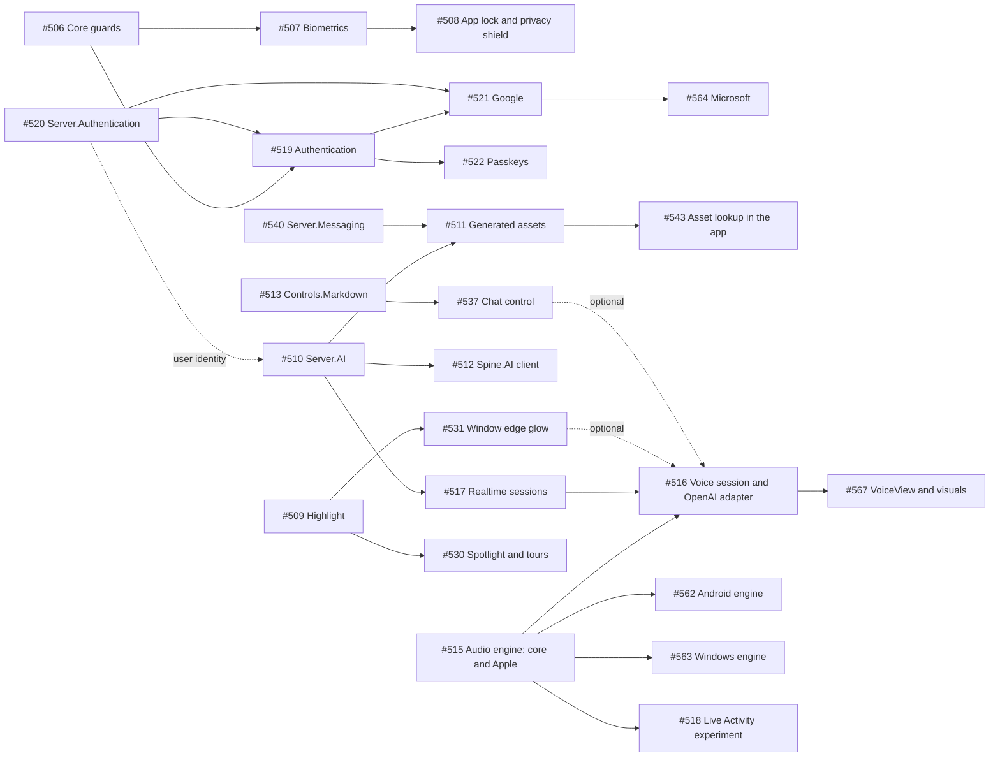

# Implementation plan: AI, voice, sign-in and app security

**Roadmap issue:** [#505](https://github.com/jonatansoderberg/Maui.Spine/issues/505)
**Started:** 2026-10-09
**Last updated:** 2026-10-19 (#632: AI functions on the device or the server with the user's context, step 2.7, in review; before that #630: VoiceView removed, a voice is drawn by AvatarView, see docs/plans/spine-avatar.md C2b)

This is the living plan for the work that came out of the AI and security brainstorm on 2026-10-09. A new session should be able to pick up from here, so every pull request that moves a step forward updates this file in the same PR.

---

## How to continue from a new session

1. Read this file, then the proposal for the step you take.
2. Check the live state of the issues. This file can lag behind GitHub, and GitHub wins:
   `gh issue list --search "505 in:body" --state all --limit 50`
3. Pick the first step in [Steps](#steps) whose status is **Ready**: its dependencies are done and its open questions are answered. If the only steps left have unanswered questions, ask the owner instead of guessing.
4. Work in a git worktree off `origin/master`. Several sessions share the main checkout, so never run `git checkout` there:
   `git fetch origin master && git worktree add ../Maui.Spine-<id> -b issue/<id>-<slug> origin/master`
5. Start the issue with the `/spine-issue <id>` workflow from `CLAUDE.md`. The issue changelog lives in `issues/<id>-<slug>.md`.
6. In the same PR:
   - set the step's status, PR and notes in [Steps](#steps)
   - add any decision you made or got to [Decisions](#decisions)
   - update **Last updated** at the top
7. Before a merge, check the files that every feature branch touches. See [Files every package PR touches](#files-every-package-pr-touches).
8. Add whatever you could not verify to the [Verification backlog](#verification-backlog), and remove the entries you did verify.

Status values: **Proposal** (written, not reviewed), **Waiting** (on another step or on an answer), **Ready**, **In progress**, **In review** (PR open), **Done**, **Parked**, **Dropped**.

---

## Principles

- **Spine is a smorgasbord.** An app takes only what it needs. The core gets small generic hooks and nothing else.
- **Every feature is its own NuGet package** and registers itself only when it is referenced (`<SpineModule>`, #355).
- **Heavy native dependencies get their own packages:** MSAL, the Google bindings, ML Kit and a markdown parser.
- **Server parts are separate packages** next to `Plugin.Maui.Spine.Server`, which stays the push backend.
- **No model abstractions of our own.** Microsoft.Extensions.AI (`IChatClient`, `IImageGenerator`, `IRealtimeClient`) is the contract. Spine adds what sits around it: configuration, cost control, UI, audio and platform integration.
- **No provider keys in an app.** Model calls and realtime sessions are set up by the app's server. Sign-in is the exception: it works both with and without a Spine server (Q7).
- **Documentation is in English:** wiki, proposals, READMEs, PR bodies and the `issues/` changelogs. Conversation with the owner is in Swedish.

---

## Package map

| Package | Kind | Issues | Proposal | Status |
|---|---|---|---|---|
| `Plugin.Maui.Spine` (core) | Navigation and command guards | #506 | [guards-biometrics §2](../proposals/spine-guards-biometrics.md) | Done (#526) |
| `Plugin.Maui.Spine.Biometrics` | New | #507, #508 | [guards-biometrics §3–§5](../proposals/spine-guards-biometrics.md) | Done (#527, #529) |
| `Plugin.Maui.Spine.Controls.Highlight` | New | #509, #530, #531 | [highlight](../proposals/spine-highlight.md) | Done (#532, #533, #534) |
| `Plugin.Maui.Spine.Server.AI` | New, server | #510, #517 | [ai §3–§5](../proposals/spine-ai.md), [voice §6](../proposals/spine-voice.md) | #510 done (#535); #517 done (#551) |
| `Plugin.Maui.Spine.Server.AI.Assets` | New, server | #511 | [ai §6](../proposals/spine-ai.md) | Done (#544) |
| `Plugin.Maui.Spine.Server.Messaging` (+ `.AzureStorage`, `.ServiceBus`) | New, server | #540 | — (design in `issues/540-*.md`, docs in `docs/wiki/messaging.md`) | Done (#541) |
| `Plugin.Maui.Spine.AI` | New | #512, #543 | [ai §7](../proposals/spine-ai.md) | #512 done (#536); #543 done (#545) |
| `Plugin.Maui.Spine.Controls.Markdown` | New (Q21) | #513 | [ai §8](../proposals/spine-ai.md) | Done (#538) |
| `Plugin.Maui.Spine.Controls.Chat` | New | #537 | [ai §8](../proposals/spine-ai.md) | Done (#539) |
| `Plugin.Maui.Spine.Voice` | New | #515, #562, #563, #516, #518 | [voice](../proposals/spine-voice.md) | #515 done (#566); #516 in review; #562, #563 and #567 wait |
| `Plugin.Maui.Spine.Authentication` | New | #519, #557 | [authentication](../proposals/spine-authentication.md) | #519 done (#558); #557 done (#561); #521 added the provider hook (#565); #564 generalizes the mode without a server |
| `Plugin.Maui.Spine.Authentication.Google` | New | #521 | [authentication](../proposals/spine-authentication.md) | Done (#565) |
| `Plugin.Maui.Spine.Authentication.Microsoft` | New | #564 | [authentication](../proposals/spine-authentication.md) | Done (#570) |
| `Plugin.Maui.Spine.Server.Authentication` | New, server | #520, #552 | [authentication](../proposals/spine-authentication.md) | #520 done (#553); #552 done (#554) |
| `Plugin.Maui.Spine.Authentication.Passkeys` and passkeys in `Server.Authentication` | New | #522, #601, #602 | [authentication, Passkeys](../proposals/spine-authentication.md) | #522 (iOS, Mac Catalyst and the server) done (#608), #611 the passkeys' details; #601 Android and #602 Windows wait |
| AI avatars and character visuals | Separate control library, specified by the owner | — | — | Outside this plan |
| On-device `IChatClient`, Android and Windows | Spike outside the repo | #514 | [ai §9](../proposals/spine-ai.md) | Proposal |

---

## Steps

The order follows value against risk. Steps in different phases can run in parallel when their dependencies allow it. Highlight (#509) and the Markdown view (#513) have no hard dependencies; the chat control (#537) follows #513.

### Phase 0: proposals and issues

| Step | What | Issue | Status | PR | Notes |
|---|---|---|---|---|---|
| 0.1 | Roadmap issue and 17 child issues | #505–#522 | Done | — | Created 2026-10-09 |
| 0.2 | Five proposals and this plan | #505 | Done | #523 | All 31 open questions answered 2026-10-09. |

### Phase 1: guards and biometrics (done 2026-10-12)

| Step | What | Issue | Depends on | Status | PR | Notes |
|---|---|---|---|---|---|---|
| 1.1 | Core navigation guard and command guard | #506 | 0.2 | Done | #526 | Must cover regions, sheets, tabs, `ShowAsync`, shortcuts and deep links. Guarded tabs on Android and Windows show an unlock cover (Q5). |
| 1.2 | `IBiometricAuth`, `[RequiresUnlock]` on pages and commands, `Unlock.Command`, `RequireAsync` | #507 | 1.1 | Done | #527 | |
| 1.3 | App lock (global) and `[PrivacyShield]` (per page) | #508 | 1.2 | Done | #529 | The core gets `SpineOverlay` and `SpineScreen`. |

### Phase 2: AI on the server and in the app

| Step | What | Issue | Depends on | Status | PR | Notes |
|---|---|---|---|---|---|---|
| 2.1 | `Server.AI`: named features, provider plug-and-play, metering, cost, budgets, cache, rate limits | #510 | 0.2 | Done | #535 | Signed-in user from #520 when present, otherwise the installation id with tighter limits (Q19). Azure storage inside the package (Q20). |
| 2.2 | Orientera adopts `Server.AI` for the race story | (Orientera repo) | 2.1 + a Spine release | Waiting | | First real consumer. Done in the Orientera repo after `SpineVersion` is bumped. |
| 2.3a | `Server.Messaging`: a general queue layer with Storage Queues and Service Bus transports, large payloads in blob storage, routing, priority, scheduling and cleanup | #540 | none | Done | #541 | Moved out of #511 by the owner on 2026-10-13, and taken first. |
| 2.3b | Generated-asset pipeline: `Server.AI.Assets` | #511 | 2.1, 2.3a | Done | #544 | Its own package on `Server.AI` and `Server.Messaging` (Decisions). Lookup 200/202/502, the app's prompt and check, versioned blob paths with `?v=`, failure records with a cool-down, per-caller order limits. Orientera's arena images are the model, and Almanacka's pictures are a candidate. |
| 2.3c | Asset lookup in the app: polling on 202, a placeholder, the failed state | #543 | 2.3b | Done | #545 | Split from #511 by the owner on 2026-10-14. `IAIAssets` (`LookUpAsync`, `WatchAsync`) and `GeneratedImage` attached properties on `Image` in `Plugin.Maui.Spine.AI`; the Showcase's Generated images page (Decisions), whose pending view is a `Shimmer` since #549. |
| 2.4 | `Spine.AI` client with on-device fallback | #512 | 2.1 | Done | #536 | The exceptions and `AIOffReason` moved to `.Common`, shared with `Server.AI`; `TaskState` shows "off" as empty through `IEmptyResultException` (Decisions). |
| 2.5a | `Controls.Markdown`: `MarkdownView` on native views | #513 | 0.2 | Done | #538 | Markdown is its own package (Q21). Split from the chat view on 2026-10-12 (Decisions). |
| 2.5b | `Controls.Chat`: the chat view with streaming, composer and tool cards | #537 | 2.5a | Done | #539 | `ChatView` and a separate `ChatComposer` in the page footer (Decisions). Renders answers with `MarkdownView`. |
| 2.6 | On-device `IChatClient` spike, Android and Windows | #514 | none | Ready | | Outside this repo. Contribute upstream to dotnet/maui-labs if it works. |
| 2.7 | AI functions: one declaration for the device and the server, the user's context on the server, text chat and voice | #632 | 2.4, 4.2, 4.3a, 5.1a | In review | #633 | A new package, `Plugin.Maui.Spine.AI.Functions` (owner, 2026-10-19). `UseFunctionInvocation` per call outside the gate and meter; device calls in text chat through a separate channel that takes results only for calls the server made; realtime tokens list the tools and the app forwards server calls to `POST /ai/functions/{feature}/{name}`, no relay (Decisions). Seen against the local sample server in the simulator: `get_my_bookings` signed in and out, `show_time` on the phone through the server. |

### Phase 3: highlight (done 2026-10-12)

| Step | What | Issue | Depends on | Status | PR | Notes |
|---|---|---|---|---|---|---|
| 3.1 | `Controls.Highlight`: the package and the per-view kinds Edge, Pulse, Sheen, Trace and Breathe; repeat, keys, `IHighlights` | #509 | 0.2 | Done | #532 | The core gets a public `ReducedMotion` with `Changed`, `Tap.Executed` and `ElementVisuals` (Windows). Shimmer and MeshBackground use the core's `ReducedMotion`. |
| 3.2 | Spotlight and tours: `TourAsync`, `SpineTargets.TryGetFrame` | #530 | 3.1 | Done | #533 | On `SpineOverlay`; `Highlight.Kind="Spotlight"` is a one-step tour. The core gets `SpineTargets`, and `SpineOverlay` on Android draws behind the system bars. |
| 3.3 | The window edge glow: `AttachEdge`, `IEdgeGlow`, `SpineOverlay.Show(…, passTouches)`, iOS corner radii | #531 | 3.1 | Done | #534 | Voice's screen-edge visual uses it. `SpineOverlay.Show(…, passTouches)` in the core; on Android a pass-through overlay is shown again above a later sheet (Decisions). |

### Phase 4: voice

| Step | What | Issue | Depends on | Status | PR | Notes |
|---|---|---|---|---|---|---|
| 4.1a | Audio engine: the shared core (queue with flush, resampler, meter, `VoiceFrame`) and the Apple engine, with the Showcase's Voice lab | #515 | 0.2 | Done | #566 | Split by the owner on 2026-10-15. Measured on the owner's iPhone: echo cancellation removes the echo to digital silence on the loudspeaker in a quiet room, and lets the user's voice through (Decisions). |
| 4.1b | Audio engine on Android: `VOICE_COMMUNICATION`, `AcousticEchoCanceler`, the microphone foreground service | #562 | 4.1a | Waiting | | Measure with the Voice lab on the owner's Android phone. |
| 4.1c | Audio engine on Windows: the communications category | #563 | 4.1a | Waiting | | |
| 4.2 | Realtime session endpoints in `Server.AI` | #517 | 2.1 | Done | #551 | OpenAI and Azure OpenAI client secrets only (Q28, and the owner's choice of token over relay on 2026-10-15). `Kind: Realtime`, `ai.Realtime(...)`, `POST /ai/realtime/{name}`, minutes reserved per token (Decisions). |
| 4.3a | `IVoiceSession` and the OpenAI adapter: token, socket, barge-in, transcript, client tools, push-to-talk, the time limit; the Showcase's Voice chat page | #516 | 4.1a, 4.2 | Done | #568 | OpenAI and Azure OpenAI only in v1 (Q28), over its own WebSocket (Decisions). Seen on the owner's iPhone: a spoken conversation, a tool, barge-in four times. |
| 4.3b | `VoiceView`, the `VoiceVisual` contract and the built-in visuals (SkiaSharp) | #567 | 4.3a | In review | | Split by the owner on 2026-10-15. A package of its own, `Plugin.Maui.Spine.Controls.Voice`; `orb`, `bars`, `ring`, `avatar`; `IVisemeSource` in Spine.Voice (Decisions). Seen in the simulator: all four against the reference, the avatar and the edge against a real session. Superseded by #630 (2026-10-19): VoiceView, its visuals and `Plugin.Maui.Spine.Controls.Voice` were removed; a voice is drawn by `AvatarView` with `VoiceAvatarDriver`, and bars and ring are built-in avatars. |
| 4.4 | Live Activity and ongoing-notification experiment | #518 | 4.1 | Waiting | | Decide afterwards whether it ships |

### Phase 5: sign-in

| Step | What | Issue | Depends on | Status | PR | Notes |
|---|---|---|---|---|---|---|
| 5.1a | `Server.Authentication`: ID-token validation, own tokens, refresh rotation, email and password, account deletion, the push `UserId` | #520 | 0.2 | Done | #553 | A minimal Azure Tables user store by default, plus `IUserResolver` (Q9). Split on 2026-10-15; email and password included by the owner (Decisions). |
| 5.1b | `Server.Authentication`: the browser broker (`/start`, `/callback`, PKCE, the one-time code; Apple web, Google web, OIDC) | #552 | 5.1a | Done | #554 | Split from #520 by the owner on 2026-10-15. `PublicUrl`, `RedirectSchemes` (custom schemes and http loopback), `WebClientId`/`WebClientSecret` per provider, Apple's `ServicesId`; the code is traded at `POST /auth/token` (Decisions). |
| 5.2a | `Authentication` client: `ISpineAuth`, tokens in secure storage, the `HttpClient` handler, `[RequiresSignIn]`, the sign-in sheet, email and password, Sign in with Apple's sheet, the push link | #519 | 1.1, 5.1a | Done | #558 | Split on 2026-10-15. Registered as `o.AddAuthentication(...)` inside `UseSpine` (Q8, kept by the owner) through a new core hook (Decisions). |
| 5.2b | `Authentication` client: browser sign-in (`WebAuthenticator`, the Windows loopback, the Android callback activity) and the mode without a Spine server (Q7) | #557 | 5.2a, 5.1b | Done | #561 | Split from #519 by the owner on 2026-10-15. `AddOpenIdConnect(name, displayName)` for brokered providers, `CallbackScheme` + `SpineAuthenticationCallbackScheme`, `UseIdentityProvider(...)` as an in-package OIDC public client (Decisions). |
| 5.3a | `Authentication.Google`: Credential Manager on Android, the broker elsewhere; the provider hook (`INativeSignIn`) in `Authentication` | #521 | 5.2a, 5.2b | Done | #565 | Split by the owner on 2026-10-15. `a.AddGoogle(g => g.ServerClientId = …)`; Guideline 4.8 checked at startup (`AppleNotRequired`); AndroidX Credentials 1.5.0.3 to stay on MAUI's AndroidX (Decisions). Compiled and unit-tested only: no Google Cloud project yet (owner, 2026-10-15). |
| 5.3b | `Authentication.Microsoft`: MSAL with the broker (Authenticator, Company Portal, WAM); MSAL's ID token to the Spine server (`AddMicrosoft`), or MSAL's own access token without one (`UseMicrosoft`) | #564 | 5.3a | Done | #570 | Split from #521 by the owner on 2026-10-15, with both modes. The mode without a server is generalized in the core (`IDirectSignIn`), shared with `UseIdentityProvider`; Mac Catalyst runs MSAL's net8.0 build with a custom web UI over Spine's browser layer (Decisions). |
| 5.4a | Passkeys on the server (Fido2NetLib, `Passkeys(...)`, the association files) and in the app on iOS and Mac Catalyst (`Authentication.Passkeys`): sign-in, sign-up, "Add a passkey", AutoFill in the sheet's email field | #522 | 5.5 | Done | #608 | Split by the owner on 2026-10-17 (Decisions). The relying party is the Azure sample server. |
| 5.4b | Passkeys on Android: Credential Manager's `CreatePublicKeyCredentialRequest` and `GetPublicKeyCredentialOption`, `assetlinks.json` from `AndroidApps` | #601 | 5.4a | Waiting | | The server side is ready: `AndroidApps` adds the `android:apk-key-hash:` origins. |
| 5.4c | Passkeys on Windows: WebAuthn through `webauthn.dll` | #602 | 5.4a | Waiting | | |
| 5.5 | Account linking: one account with several providers, `Logins` with their details, link and unlink, and a pending identity before a new account (`AskBeforeNewAccount`) with "Is this your first time here?" in the sheet; the sheet's provider buttons in one shape with each brand's logo | #575 | 5.3b | Done | #576 | Asked for by the owner on 2026-10-16 (Decisions). Also `Password`, `AccountLink` and `Merge` in the icon set, and Spine.Svg draws Figma's conic gradients and alpha masks (Google's G). |

---

## Verification backlog

These are behaviours that are merged but have not been seen working. Take one when the hardware or setup is at hand (a Windows machine, a Mac with Touch ID, a phone), then remove the entry and say in the PR or commit what was seen.

| Step | What has not been verified | What it takes | How |
|---|---|---|---|
| 2.7 (#632) | Apple Intelligence calling a device function (`show_time`) through Spine.AI: in the iPhone 17 Pro simulator FoundationModels fails even without tools, and the Mac's model was not downloaded ("The model is not available") | The owner's iPhone with Apple Intelligence | The Showcase's AI client page: "Vad är klockan?" answered on the device |
| 2.7 (#632) | A voice session calling `get_my_bookings` on the server signed in and out, and `show_time` switched to the server with "Read the clock on the server" (only unit-tested: no OpenAI key locally) | The Azure sample server after a deploy, or a key in user secrets | The Showcase's Voice chat page |
| 2.7 (#632) | `gpt-5.4-nano` choosing the tools in text chat (only the demo provider was seen) | The Azure sample server after a deploy | The Showcase's Chat page, Server, signed in and out |
| 2.7 (#632) | Pending device calls in `IDistributedCache` across instances, and `SpineAIEndpoints.FunctionAsync` under Azure Functions (only the in-memory store ran; Functions only compiled) | Redis or a second instance; the scratch Functions AppHost | Two servers behind one address, a device call answered on the other |
| 1.1 (#506) | Guards on Windows at run time: a guarded page, command and tab. The tab should show the guard's cover. | A Windows machine | A scratch app with two `[NavigableTab]` pages, one guarded (see below), plus the Showcase Guards page |
| 1.1 (#506) | Android and Windows tabs fall back to switching back when the guard has **no** `IGuardCover` | Emulator | A guard that implements only `IGuard<T>` on a tab; tap the tab, refuse; the previous tab should come back and the guarded tab's page should never show |
| 1.1 (#506) | A cold start through a shortcut or a search result to a guarded page. The guard should wait for activation and the root page, then ask over the root. | Simulator or phone | Showcase: put a guard on the page a shortcut opens, kill the app, open it from the shortcut |
| 1.2 (#507) | Windows Hello at run time: `UserConsentVerifierInterop` with the window handle, the result mapping, the availability | A Windows machine with Hello (a PIN is enough) | Showcase Biometrics page |
| 1.2 (#507) | Touch ID on a Mac (Mac Catalyst) | A Mac with Touch ID | Showcase Biometrics page on Mac Catalyst |
| 1.2 (#507) | Fingerprint on Android: `BIOMETRIC_WEAK` with an enrolled finger | An emulator with a fingerprint enrolled in Settings (needs a screen lock), then `adb emu finger touch 1` | Scratch tabbed app or Showcase |
| 1.2 (#507) | The lock-out message after too many failed attempts | Simulator: several `notifyutil -p com.apple.BiometricKit_Sim.pearl.nomatch`; Android: repeated wrong fingerprints | Showcase Biometrics page, Unlock button |
| 1.2 (#507) | `WhenUnavailable = Deny` shows its message on a device without a screen lock | Android emulator without a lock | Scratch app with `UseSpineBiometrics(o => o.WhenUnavailable = UnavailablePolicy.Deny)` |
| 1.3 (#508) | Windows at run time: `WDA_EXCLUDEFROMCAPTURE` on a `[PrivacyShield]` page, the app lock after a minimise and after hiding to the tray (the `AppWindow.Changed` watcher), the lock screen's popup over a sheet's popup and its size when the window is resized | A Windows machine with Hello | Showcase Biometrics page: turn on the app lock, open the Statement page, try the Snipping Tool, minimise and restore |
| 1.3 (#508) | Mac Catalyst: the lock screen and Touch ID after a minimise. The minimise itself was seen to count (the clock's stop time set and cleared), but the cover and the prompt were not run, so as not to put a Touch ID prompt on the owner's screen | The owner at a Mac with Touch ID | Showcase on Mac Catalyst, app lock on, minimise and restore |
| 1.3 (#508) | `PrivacyShield(CoverWhileCaptured = true)` on iOS 17 and later: the cover while the screen is recorded or mirrored. `simctl io recordVideo` does not set the scene's capture state | An iPhone | The Statement page, then screen recording from Control Center |
| 1.3 (#508) | Android before API 30: the device credential is an activity of its own, so the app stops during the prompt. The app lock should not lock again after the PIN | An API 28 or 29 emulator with a PIN | Showcase, app lock on, return from the background and unlock with the PIN |
| 1.3 (#508) | A `Relock` page in a sheet: Back on the lock screen closes the sheet (`CanGoBack` is true for a sheet's page) | Simulator | A scratch sheet page with `[RequiresUnlock(…, Relock = true)]` |
| 3.1 (#509) | Windows at run time: every kind on Composition (Edge's turning linear gradient, the drop-shadow glow and halo), `ElementVisuals` with Tap and Highlight on one element, Tap's press fill and Narrator after the move to the shared container, `IsInWindow` while scrolling | A Windows machine | Showcase Highlight page and Rows page |
| 3.1 (#509) | Screen readers: the tip announced when a highlight starts, and the semantic hint while Edge, Trace or Breathe runs | VoiceOver on a phone or the simulator's Accessibility Inspector; TalkBack on the emulator | Showcase Highlight page, Summarise |
| 3.1 (#509) | Android before API 31 and before API 28: the glow and halo through `BlurMaskFilter`, and the ring fallback without blur | An API 28–30 and an API 26 emulator | Showcase Highlight page, Every kind |
| 3.1 (#509) | Mac Catalyst at run time, and the other kinds on an iPhone. Edge over Liquid Glass was seen on the owner's iPhone on 2026-10-12 | The owner's Mac and iPhone | Showcase Highlight page |
| 3.1 (#509) | Android: a look change mid-run without a blink. The recording held only 23 frames (the emulator records on change) | A phone, or `screenrecord` with the emulator idle | Change Intensity on the Every kind page while recording |
| 3.2 (#530) | Windows at run time: a tour over the popup, Escape, the title bar's `PageAction` and the `NavigationView` tab item as targets | A Windows machine | Showcase Highlight page, and the scratch tabbed app from the test recipes |
| 3.2 (#530) | Screen readers during a tour: the card's focus and "Step 2 of 3" announced, and the dim out of the accessible tree | VoiceOver or TalkBack | Showcase Highlight page, Take the tour |
| 3.2 (#530) | A tour while a sheet is open, and one cut short by a sheet opening (`Cancelled`) | Simulator and emulator | A scratch sheet page that runs a tour |
| 3.3 (#531) | The window edge's corners on other iPhones and on iPads: the table holds published radii, checked only on the iPhone 17 simulator (against `simctl io screenshot --mask=black`) | Other simulators or devices | Showcase Highlight page, The window's edge, a masked screenshot |
| 3.3 (#531) | Windows at run time: the edge over the window, `passTouches` on the popup, `CompositionTarget.Rendering` driving the level | A Windows machine | Showcase Highlight page |
| 3.3 (#531) | Once on iOS, after toggling Reduce Motion while the window edge ran, the XAML spotlight of the Highlight page showed though its `IsActive` binding was false. Not reproduced in three tries | Simulator | Highlight page: Model working, Stop, Reduce Motion on, Speaking |
| 2.1 (#510) | The Anthropic adapter: what it fills in `UsageDetails` (cached input, and cache writes in `AdditionalCounts`), streaming usage, and `Reasoning` mapped to its thinking mode. Orientera's `Story__ApiKey` answered 401 on 2026-10-12, so only OpenAI was called | A valid Anthropic key in the push sample server's user secrets (`Ai:Providers:anthropic:ApiKey`) | The sample server's `send.http`, `/sample/summary` with `"feature": "Story"`, then `GET /ai/usage` |
| 2.1 (#510) | Azure Functions on Azure, not only under the local Functions host: SSE through the Azure front end without buffering, `AzureWebJobsStorage` as the usage store, the report | A deployed Functions app (Orientera, step 2.2) | Stream an exposed feature with `curl -N` and check the events arrive one at a time |
| 2.1 (#510) | `AzureTableAIUsageStore` against a real storage account (checked against Azurite only), and response caching over Redis | Orientera's storage account after step 2.2 | Two calls, the report, and a cached repeat |
| 2.5a (#513) | Screen readers cannot open a link inside text: the paragraph's hint lists the links, and the tap is on a span (the owner's v1 choice). Also not heard yet: VoiceOver and TalkBack on headings, task markers and the Copy button | VoiceOver on a phone, TalkBack on the emulator | Showcase Markdown page |
| 2.5a (#513) | Windows and Mac Catalyst at run time (only compiled and built): spans with a background and gestures, the code block's horizontal scroll, the table grid | A Windows machine; the Mac app | Showcase Markdown page |
| 2.5b (#537) | Windows and Mac Catalyst at run time (only compiled and built): the composer's height and centring, the context menu's Copy, the follow and the jump button | A Windows machine; the Mac app | Showcase Chat page |
| 2.5b (#537) | Enter to send on a Mac and Windows: Enter makes a new line in v1, and MAUI's `Editor` does not tell Enter from Shift+Enter | Platform key handling on the editor | Showcase Chat page with a hardware keyboard |
| 2.5b (#537) | Screen readers: "You: …" and "Assistant: …", the one announcement per answer, the thinking state, Send, Stop and the jump button | VoiceOver on a phone, TalkBack on the emulator | Showcase Chat page |
| 2.5b (#537) | `ToolCallTemplate` and `ThinkingTemplate` are not exercised by the Showcase; only the built-in card and shimmer were seen | A sample or app that sets them | A page with a Highlight `Edge` card as thinking |
| 2.5b (#537) | Long histories: the list is not virtualised (the owner's v1 choice). Not measured above a few dozen messages | A conversation of several hundred messages | A scratch page that fills `Messages` |
| 2.3a (#540) | Real Azure: a Storage account and a Service Bus namespace, with managed identity (`Credential`) rather than connection strings. Only Azurite and the emulator were used | An Azure subscription (Orientera's, step 2.2) | The sample with `ConnectionStrings` pointing at Azure, `send.http` |
| 2.3a (#540) | Functions on Azure: scale-out per lane, a high lane overtaking a normal backlog under load, `maxAutoLockRenewalDuration` for long handlers, and the Storage trigger's `-poison` queue rescued by the janitor (only Service Bus's dead-letter queue was rescued end to end) | A deployed Functions app | A flood of normal pictures, then a few high ones; a handler that kills the process |
| 2.3a (#540) | Throughput on the cloud services. Locally the emulators set the pace (Azurite about 75 handled/s at 10,000 queued, the Service Bus emulator about 70/s; the pump alone 16,000/s in memory) | Azure | `ThroughputTests` with `SPINE_MESSAGING_THROUGHPUT=1` against Azure connection strings |
| 2.3a (#540) | Queue encoding `none` with Functions (host.json `"messageEncoding": "none"`), Service Bus Premium with a larger `MaxBodyBytes`, and the janitor's lease renewal past 60 s on a large purge | Azure; a store with many days of data | — |
| 2.3b (#511) | Real Azure: a storage account that allows blob public access, the container created public, and one that forbids it stopping the host with its message; a CDN in `PublicBaseUrl`. Only Azurite was used | An Azure subscription (Orientera's) | The messaging sample's API with `ConnectionStrings:blobs` pointing at Azure |
| 2.3b (#511) | The assets subscriber in Azure Functions (a Storage-queue trigger calling `DispatchAsync("spine-ai-assets", …)`) and `SpineAIAssetEndpoints.GetAsync` from an HTTP function. Only the ASP.NET Core pump and `MapSpineAIAssets` ran | A Functions app, locally under Aspire or on Azure | Add the two functions to `SpineMessagingSample.Functions` and order a postcard |
| 2.3b (#511) | The messaging sample's AppHost with the key passed as the secret parameter `openaikey`. The real postcard was made with the API run on its own against Azurite in Docker | Docker | `Parameters__openaikey=… dotnet run --project samples/SpineMessagingSample.AppHost`, then `send.http` |
| 2.3b (#511) | A model that answers with a URL (`UriContent`) rather than bytes: the handler downloads it. OpenAI's gpt-image models answer with bytes | Such a provider | — |
| 2.3c (#543) | `GeneratedImage` on Android, Windows and Mac Catalyst at run time (only compiled), and on a phone. Seen on the iPhone 17 Pro simulator: pending (a spinner in #543, a `Shimmer` since #549, light theme only), ready from blob storage, failed, polling stopped in the background and resumed at once | An emulator, a Windows machine, the Mac app | The Showcase's Generated images page against the messaging sample's API; `adb reverse tcp:5240 tcp:5240` on Android |
| 4.3a (#516) | Azure OpenAI's realtime socket from the app (only OpenAI was called), a session through `TimeLimit` on a device, a phone call during a session, `SpineVoiceBackground` with the screen locked, and the session on Mac Catalyst | An Azure OpenAI deployment; the iPhone; a second phone | The Voice chat page |
| 4.3b (#567) | `VoiceView` on the iPhone, Android, Windows and Mac Catalyst (only the iOS simulator), with Reduce Motion on (only the visuals' tests), VoiceOver's announcements of the state, and a `VoiceVisualView` of an app's own (no test or sample hosts one) | The iPhone; an emulator; the Mac app | The Showcase's Voice visuals and Voice chat pages |
| 4.1a (#515) | A Release build on the iPhone: CPU was 50–60 % of one core in Debug, which runs the interpreter; the resampler's kernel is now a table, measured only in Debug | The iPhone, and disk room for an AOT build (the owner asked not to build Release on 2026-10-15) | The Voice lab's echo test in a Release build |
| 4.1a (#515) | A Bluetooth headset (HFP), the latency from the speaker to the microphone (the cross-correlation gave 71–161 ms on the loudspeaker and failed on the receiver), an interruption by a phone call, and a route change mid-conversation | A headset; a second phone to call from | Voice lab: Start, then call the phone, or connect the headset |
| 4.1a (#515) | Mac Catalyst's echo cancellation: voice processing came on, but the echo barely rose above the room (−39.6 against −38.5 dBFS), so the 7 dB removed says little | A quieter room and a higher volume on the Mac | Voice lab on Mac Catalyst |
| 4.1a (#515) | `SpineVoiceBackground=true`: a conversation with the screen locked | The iPhone | A scratch app with the property set |
| 4.2 (#517) | Azure OpenAI's `client_secrets` and its WebSocket with an `ek_` token as bearer; only built from Microsoft's docs and tested against a stub | An Azure OpenAI resource with a realtime deployment | `ai.Realtime("azure", AIRealtimeProviders.AzureOpenAI)`, then the check below against its `url` |
| 5.1a (#520) | A real Sign in with Apple ID token from the native sheet, Apple's code exchange and revocation, and real Google and Microsoft tokens. Only stub issuers and a stub of Apple's endpoints were used | The iPhone with the app half (#519), an Apple key, Google and Entra client ids | The push sample server's `/auth/apple/token` with `Auth:Apple:*` in user secrets |
| 5.2a (#519) | Sign in with Apple's sheet on a device (seen in the iPhone 17 simulator on 2026-10-16 with the owner's Apple ID: the sheet, the server's check against Apple's keys, the names and the email; #571 fixed the entitlements on the way); Apple's token revocation at account deletion, which needs the Sign in with Apple key; the client on Android, Windows and Mac Catalyst at run time (only compiled); the push link with a real push token. Seen on the iPhone 17 Pro simulator: sign-up, the code, `[RequiresSignIn]` on a page and on a command, cancel, a call through the handler, sign-out, a restart that kept the session | `-p:SpineSignInWithApple=true` on the iPhone (the App ID has the capability and `Spine Showcase Development` was regenerated on 2026-10-16); a Sign in with Apple key in the push sample server (`Auth:Apple:TeamId`, `KeyId`, `PrivateKey`) for revocation; an emulator; a Windows machine | The Showcase's Sign-in page against the push sample server on 5100 (`adb reverse tcp:5100 tcp:5100` on Android); codes are in the server's log. The MCP `text` tool types `@` as `2`, so paste emails with `xcrun simctl pbcopy` |
| 5.3b (#564) | Microsoft on Android (the broker, Custom Tabs, the signature-hash redirect), Windows (WAM) and Mac Catalyst (the custom web UI) at run time; a work or school account (the organization, an email with `xms_edov`). Seen on the iPhone 17 simulator against the Entra registration "Spine Showcase sign-in" with a personal account: `AddMicrosoft` (sign-in, the server's token, `/sample/me`, sign-out clearing MSAL, the picture, the names), `UseMicrosoft` (sign-in, Graph `/me` and `/me/photo`, a restart, silent renewal) | An emulator with space, a Windows machine, the Mac app, Authenticator on the iPhone, a work account | The Showcase built with `-p:SpineMicrosoftClientId=08c05546-bfed-4c91-8dcb-6cb159293fd8` against the push sample server (its `Auth:Microsoft:ClientId` is set) |
| 5.3a (#521) | Credential Manager on Android (the nonce, auto-select on the second sign-in, sign-out clearing the state, no account on the device, no Google Play services falling back to the broker). Seen in the iPhone 17 simulator on 2026-10-16 against the real Google: "Continue with Google" through the push sample server's broker, the code traded at Google, the token checked, the picture, names and verified email | An emulator with a Google Play image and a signed-in account, and space for the app | The Google Cloud project "Spine Showcase" (spine-showcase, jonatan.soderberg@gmail.com) has the consent screen in Testing with the owner as test user, a Web client (id in the push sample server's `Auth:Google:WebClientId`, secret in `WebClientSecret`) and an Android client for `se.cosmomedia.spineshowcase` with the debug key's SHA-1. Build the Showcase with `-p:SpineGoogleServerClientId=960077195458-1o1a44udsn02cp7f7jluon7qhi4v843o.apps.googleusercontent.com` |
| 5.2b (#557) | The browser sign-in against a real provider: Google and Apple through the broker, and the mode without a server against Auth0 or Entra ID. Custom Tabs and the callback activity on Android at run time (the merged manifest was checked; both emulators were busy or full on 2026-10-15). The Windows loopback. Seen on the iPhone 17 simulator against a local OIDC stub in the mode without a server: cancel, sign-in with PKCE and nonce, a restart that kept the session, a refresh, a revocation at sign-out. The brokered flow ran in tests only, against a real `Server.Authentication` broker | A Google web client (`Auth:Google:WebClientId`/`WebClientSecret` in the push sample server's user secrets) and Apple's Services ID; an emulator with space; a Windows machine; an Auth0 or Entra tenant | The Showcase's Sign-in page built with `-p:SpineGoogleServerClientId=<web client id>` against the push sample server on 5100 (`adb reverse tcp:5100 tcp:5100`); for the mode without a server, `a.UseIdentityProvider(...)` in a scratch build |
| 5.1b (#552) | The browser sign-in against real Apple, Google and OIDC web clients: the callback, the code exchange, Apple's form_post and its `user` JSON. `/start` reached the real authorize pages through real discovery with placeholder client ids; everything after ran only against stubs | A Services ID with a return URL, a Google web client | The push sample server with `Auth:Apple:*` or `Auth:Google:*` in user secrets, a public URL (a tunnel) for Apple, which refuses `http://localhost` return URLs |
| 5.1a (#520) | `SpineAuthEndpoints` under Azure Functions (only compiled) | The scratch Functions AppHost | The Functions recipe below |
| 4.2 (#517) | `SpineAIEndpoints.RealtimeSessionAsync` under Azure Functions (only compiled) | The scratch Functions AppHost | The Functions recipe below |
| 2.3c (#543) | `GeneratedImage` in a recycled `CollectionView` cell whose key changes while an image is pending. Only a `BindableLayout` was used | Simulator | A scratch page with a long list of keys |
| 2.4 (#512) | Windows at run time (only compiled), and Mac Catalyst at run time (only built) | A Windows machine; the Mac app | Showcase AI client page against the push sample server |
| 2.4 (#512) | A release build on a phone over the network: cleartext is off there, and the client was checked only against `http://localhost` in Debug | A phone and an HTTPS backend (Orientera after step 2.2) | Any feature through `https` |

**Test recipes that worked**
- **The echo test on the iPhone without taps.** Use a scratch `[ModuleInitializer]` that reads `SPINE_NAV=VoiceLab`, opens the page through `INavigationService`, then finds the page in the window's visual tree and runs `RunEchoTestCommand`. `SPINE_VOICE_SPEAKER=0` chooses the receiver. It also prints the view model's `Status` and `Results` to the console.
  - Build with `-p:CustomBeforeMicrosoftCommonTargets=<scratch>/harness.targets`.
  - Launch with `xcrun devicectl device process launch --console --environment-variables '{"SPINE_NAV":"VoiceLab","SPINE_VOICE_TEST":"1","OS_ACTIVITY_DT_MODE":"enable"}'`.
  - Fetch `Library/voice-lab.json` and the two WAV takes with `devicectl device copy from --domain-type appDataContainer`.
  - The phone must be unlocked and on the cable. It drops to `unavailable` when it locks, and an install then fails mid-way.
  - On the Mac, run `open -n --env SPINE_NAV=VoiceLab --env SPINE_VOICE_TEST=1 --stdout <file>`. The Mac app's container is closed to other processes, so read the console instead.
- **Face ID in the iOS simulator.**
  - Enrol with `xcrun simctl spawn <udid> notifyutil -s com.apple.BiometricKit.enrollmentChanged 1`, then `notifyutil -p com.apple.BiometricKit.enrollmentChanged`.
  - Answer a prompt with `notifyutil -p com.apple.BiometricKit_Sim.pearl.match` or `…pearl.nomatch`.
- **Android prompt without enrolling a finger.**
  - `adb shell locksettings set-pin 1234` gives a device credential.
  - Type it in the prompt with `adb shell input text 1234` and `input keyevent 66`.
  - Clear it afterwards with `locksettings clear --old 1234`.
  - The prompt's window blocks screenshots. Check `dumpsys window | grep mCurrentFocus` (it reads `BiometricPrompt`) and `uiautomator dump` instead.
- **The app switcher in the iOS simulator.** Press Home (the simulator tool's `button HOME`), then a `touch_path` from (201, 872) up to about y = 600 with two 400 ms holds at the end opens the app switcher on an iPhone 17. Tap the card to return.
- **Android capture.**
  - `adb exec-out screencap -p` comes out black for secure windows.
  - `dumpsys window windows` lists `SECURE` in each window's `fl=`, sheet dialogs included, and the windows top first.
  - The overview's card is live when opened straight from the app. Go home first, then press `KEYCODE_APP_SWITCH` (187) to see the stored thumbnail.
- **Mac Catalyst lifecycle.** The Showcase harness reads commands from stdin when the app is started with `open -W --stdin <fifo> --stdout <file>` (LaunchServices). Started from the binary directly, no scene events came at all. `NSApplication.sharedApplication.windows` holds status-bar windows too, so pick the `UINSWindow` before `miniaturize:`. Log `UIApplication.ConnectedScenes[].ActivationState` to see what UIKit reports.
- **Tabs.** The Showcase has no tabs. Use a scratch MAUI app outside the repo with these settings:
  - the repo's `global.json` copied next to it
  - `Microsoft.Maui.Controls` pinned to the repo's version (10.0.50)
  - a `ProjectReference` to the worktree's `src/Plugin.Maui.Spine` (and `.Biometrics`)
  - two `[NavigableTab(Title = …, Order = 0/1)]` `SpinePage` classes built in code (a distinct `Order` is required)
  - `App : SpineApplication<FirstTab>`

  On Android, build with `-p:EmbedAssembliesIntoApk=true -t:SignAndroidPackage` and install with adb.
- **`Server.AI` under Azure Functions.** Build a scratch Aspire AppHost and Functions app outside the repo, in the shape of Orientera's:
  - versions: `Aspire.AppHost.Sdk` 13.4.6, Functions Worker 2.52.0, `Http.AspNetCore` 2.1.1, and the repo's `global.json`
  - storage: `AddAzureStorage(...).RunAsEmulator()` without pinned ports or a data volume, so it never touches Orientera's emulator
  - the usage store: the Functions app gets its connection from `ConnectionStrings:tables`
  - `func` from `~/.npm-global/bin` has to be on `PATH`
  - the Functions host listens on the port that `lsof` shows for `func`
  - stopping: `kill` the AppHost process. A Functions worker that `func` restarted may survive it, so check with `pgrep -fl Fx.dll`
- **Realtime tokens live.** Run the push sample server with `Ai__Providers__openai__ApiKey` read from `~/.config/openai.env`. Then a file-based C# app (`dotnet run check.cs`, with the repo's `global.json` beside it) posts to `/ai/realtime/Voice` and opens the answer's `url` with `ClientWebSocket` and `Authorization: Bearer {token}`. The first event is `session.created`, carrying the server's voice, VAD, transcription and instructions. With no audio sent, the session costs nothing, but each token reserves its minutes in the sample's in-memory budget.
- **The Spine.AI client in the Showcase.**
  - **Start the push sample server** (`dotnet run` in `samples/MauiSpinePushNotificationsSampleApp.Server`). The AI client page uses `http://localhost:5100/ai`, and Android reaches it after `adb reverse tcp:5100 tcp:5100`. 10.0.2.2 does not reach the host from the emulator's app traffic.
  - **A harness that loads before the page exists misses its first `nav` on Android** after a cold start. Tap the row, or wait for the main page.
  - **To check streaming,** record `simctl io recordVideo`, extract frames at 4 fps with ffmpeg, and count the dark pixels of the answer's card per frame. The count grows frame by frame while the text streams.
  - **Clean up afterwards.** The client writes the installation id to `SecureStorage` (`spine.push.installation-id`), which the Showcase never sets otherwise. Remove it with a harness command (`SecureStorage.Default.Remove`) on both platforms, then install a clean build.
- **`Server.AI` tests against Azurite.** Run `~/.npm-global/bin/azurite-table --inMemoryPersistence --tablePort 10002`, then `dotnet test tests/Plugin.Maui.Spine.Server.AI.Tests`. The Azurite facts skip when nothing listens on 10002.
- **Pending and failed images without paying.** Run the messaging sample's API with `Ai__Providers__openai__ApiKey=sk-invalid-for-testing` and a raised `Ai__Features__Postcard__Asset__Version`. Every postcard is then ordered again: pending for about 90 seconds while the three attempts fail, then failed with the reason `model`. Already-made images of the old version are not touched.
- **Opening a Showcase page in the simulator without taps.** Use a scratch `[ModuleInitializer]` that reads `SPINE_NAV` and calls `INavigationService.NavigateToAsync<Page>()` after 4 seconds. Build with `-p:CustomBeforeMicrosoftCommonTargets=<scratch>/harness.targets`, then `SIMCTL_CHILD_SPINE_NAV=GeneratedImages xcrun simctl launch <udid> se.cosmomedia.spineshowcase`. The main page's hero makes swipe navigation unreliable.
- **Generated assets end to end.** Run Azurite in Docker (`docker run -d --name … -p 10000-10002:10000-10002 mcr.microsoft.com/azure-storage/azurite azurite --blobHost 0.0.0.0 --queueHost 0.0.0.0 --tableHost 0.0.0.0 --skipApiVersionCheck`), then the messaging sample's API alone with `ConnectionStrings__blobs` and `ConnectionStrings__queues` set to `UseDevelopmentStorage=true` and the OpenAI key in `Ai__Providers__openai__ApiKey`. Poll `GET /ai/assets/Postcard/visby` until 200, then fetch the URL without credentials. One `gpt-image-1-mini` postcard at 1024x1024 was a 2.5 MB PNG. `dotnet test tests/Plugin.Maui.Spine.Server.AI.Assets.Tests` runs its Azurite facts against the same container. Remove the container afterwards.
- **Provider keys for live calls without printing them.** Read OpenAI's key from `~/.config/openai.env` into an environment variable inside the command that needs it, for example `Ai__Providers__openai__ApiKey`. List the names of keys in a settings file, never their values (see the memory "Secret names only").

## Decisions

Newest last. Each entry is dated and says who decided.

- **2026-10-09, owner:** Biometrics should also work on commands, not only on pages.
- **2026-10-09, owner:** App lock is both a per-page attribute and a global setting.
- **2026-10-09, owner:** Secrets bound to biometrics (Keychain access control, Keystore CryptoObject) are dropped for now.
- **2026-10-09, owner:** Sign-in should be easy to add, options-style. It covers Sign in with Apple, Google, Microsoft and generic OIDC; passkeys are a maybe.
- **2026-10-09, owner:** BankID is skipped. A broker that speaks OIDC works through `AddOpenIdConnect` if it is ever needed.
- **2026-10-09, owner:** The glow becomes a general highlight for focus and onboarding, with once, repeat and similar modes.
- **2026-10-09, owner:** On-device models for Android and Windows do not belong in Spine. A proof of concept is fine.
- **2026-10-09, owner:** Voice must work out of the box against realtime AI, visualise input and output audio, and take visual agents or avatars as plug-ins.
- **2026-10-09, owner:** A Live Activity for a voice conversation is worth testing.
- **2026-10-09, owner:** AI providers are plug-and-play, and consumption and cost are under control.
- **2026-10-09, owner:** What is general in Orientera's AI code moves to the framework, and the domain parts stay.
- **2026-10-09, owner:** Everything is modular: separate NuGet packages, so an app does not get what it does not use.
- **2026-10-09, Claude:** Microsoft.Extensions.AI is the model contract, so Spine writes no provider abstraction and no Spine package per provider. **Why:** M.E.AI already has the interfaces, middleware and provider adapters, and Microsoft.Maui.Essentials.AI already covers Apple's on-device model.
- **2026-10-09, Claude:** Realtime voice uses WebSocket and PCM first. **Why:** there is no maintained libwebrtc binding for MAUI.
- **2026-10-09, owner:** Answered Q1–Q31; see the answer column in [Open questions](#open-questions). The answers that change a proposal:
  - Q5: guarded tabs show an unlock cover.
  - Q7: sign-in works without a Spine server too.
  - Q8: registration is `o.AddAuthentication(...)` in `UseSpine`.
  - Q9: a minimal Azure Tables user store and `IUserResolver`, with no Identity default.
  - Q11: the push link is opt-in.
  - Q20: Azure storage stays in `Server.AI`.
  - Q21: Markdown is its own package.
  - Q26: background audio is opt-in.
  - Q28: only OpenAI and Azure OpenAI in v1.
- **2026-10-12, Claude (#507):** `Xamarin.AndroidX.Biometric` is pinned at 1.1.0.30, the last build on MAUI 10.0.50's AndroidX releases. Lift it together with MAUI. **Why:** later builds raise Activity, Fragment and Lifecycle above MAUI's pins (NU1608, binding drift as in #451).
- **2026-10-12, owner (#508):**
  - The core gets small public hooks (`SpineOverlay`, `SpineScreen`), not `InternalsVisibleTo` for the package.
  - A `Relock` cover has a Back button that leaves the page without unlocking.
  - `LockAfter` defaults to zero.
- **2026-10-12, Claude (#508):** On Mac Catalyst MAUI follows the application's lifecycle and raises no `Window.Stopped` when the window is minimised: the scene goes to the background while the application stays active. The package watches the window's scene itself, and on Windows the `AppWindow`'s minimised and hidden state. **Why:** the owner's Q6 counts minimised time, and without it neither the app lock nor #507's forgetting worked on a Mac.
- **2026-10-12, Claude (#508):** On Android a sheet that opens while a `SpineOverlay` shows is held invisible under it until the overlay goes. **Why:** showing the overlay's dialog again to get back on top left two frames of the app's page in a recording.
- **2026-10-12, Claude (#508):** `SpineOverlay` on Apple is a view on the window. It is raised again in the sheet's `ViewWillAppear` and when the window first becomes visible. **Why:** a recording showed a sheet sliding over the lock screen for half a second when it was raised straight after `PresentViewController`, and on a cold start the root view went in above it at `MakeKeyAndVisible`.
- **2026-10-12, owner (#509):**
  - Highlight is split into three issues and PRs: #509 (the core hooks, the package and the five per-view kinds), #530 (Spotlight and tours) and #531 (the window edge glow with `passTouches`).
  - Shimmer and MeshBackground move onto the core's public `ReducedMotion` in #509.
- **2026-10-12, Claude (#509):** `Tap.Executed`, the proposal's fallback hook, is in the core. **Why:** on Android a MAUI `TapGestureRecognizer` on a view with `Tap.Command` took the tap: the highlight ended but the row's command did not run (seen on the emulator). Highlight listens to `Tap.Executed` on such views.
- **2026-10-12, Claude (#509):** On Android the drawable goes in the parent's overlay at the view's place, not the view's own. **Why:** a `Border` clips to its shape, and its own overlay showed no glow or rings outside it.
- **2026-10-12, Claude (#509):** A run's time counts only while the view can be seen: loaded, visible, in the window (followed through its `ScrollView`s and lists), on a page in `SpineScreen.ShownPages`, and the app in front. **Why:** in the first run, hints below the fold played out, and a key would count as seen with nobody looking.
- **2026-10-12, Claude (#509):** A new look while a highlight runs (size, colour, intensity, theme) redraws it without a fade and keeps its phase on Apple and Android. **Why:** a card that grows while Edge runs would otherwise blink; checked frame by frame in recordings.
- **2026-10-12, Claude (#509):** Trace's head is the kind's colour, not white as on the concept page. **Why:** a white head read as a gap on a light card.
- **2026-10-12, Claude (#531, decided early):** A `passTouches` overlay on Android does not hold a later sheet under it (`HoldUnder`); it is shown again above the sheet. **Why:** a glow that takes no touches must not hide a sheet, and a frame without the glow does no harm. `HoldUnder` stays for overlays that take touches.
- **2026-10-12, owner (#530):** `Highlight.Kind="Spotlight"` stays as a kind: a one-step tour of the view that waits for a tap whatever `Repeat` says. A spotlight covers the window, so it must not go by itself or come back.
- **2026-10-12, owner (#530):** A spotlight's hole has the target's shape: its corner radius grown by the padding (a `Border`'s corners, a button's rounding, a round header action, a capsule tab on iOS 26), not a circle round every small target.
- **2026-10-12, Claude (#530):** A view shown with `SpineOverlay` gets no `Width` or `Height` of its own (it has no MAUI parent to arrange it), and MAUI applies the safe area to it. The spotlight reads the window's size from its platform view and turns the safe area off. **Why:** the first tour on iOS waited for a size that never came, then drew the dim one status bar too low.
- **2026-10-12, Claude (#530):** `SpineOverlay`'s dialog on Android draws the system bar backgrounds (`DRAWS_SYSTEM_BAR_BACKGROUNDS`). **Why:** without it the system painted black bars over the app behind the status and navigation bars, so the dim stopped short of them.
- **2026-10-12, Claude (#530):** iOS 26's floating tab bar draws each tab button twice (once more for the selected tab's lens), so `SpineTargets` takes one control per place in the bar. If the count still does not match the tabs, the item gets an equal share of the bar.
- **2026-10-12, Claude (#530):** Escape skips a tour on Windows only. Mac Catalyst would need a key command on a responder in the overlay's window, which `SpineOverlay` does not have; Skip and a tap work there.
- **2026-10-12, Claude (#531):** The window edge's level is read by a frame clock of the platform's own (`CADisplayLink`, `Choreographer`, `CompositionTarget.Rendering`), not MAUI's ticker. **Why:** MAUI's Android ticker stops when animations are removed, and under Reduce Motion the level must still show.
- **2026-10-12, Claude (#531):** The window edge is the per-view Edge on a view the window's size, with `Outset` 36. Edge's glow and rim scale with `Outset` above the default 12. **Why:** the outer half of the glow is off screen. At the per-view strength, the owner found the window's edge too subtle ("lätt att missa"); a view with the default outset looks as before.
- **2026-10-12, Claude (#531):** On Android the pass-through overlay is raised above a later sheet by opening a new dialog with its view and closing the old one. That view leaves and joins a window, so the glow is out for about 0.27 s and fades back in, as measured in a recording. **Why:** `Hide` then `Show` keeps a window's place, and holding the sheet back is worse for a glow.
- **2026-10-12, Claude (#531):** A rebuild of a highlight's layers mid fade-in continues the fade from where it was. **Why:** a recording showed the window edge jump in at full strength when its view was laid out again just after it appeared.
- **2026-10-12, owner (#510):**
  - #510 stays one issue and one PR, not split.
  - Per-caller limits are two blocks, `SignedIn` and `Installation`. `Installation` also covers anonymous callers and falls back to `SignedIn` when unset.
  - The push sample server gets the Anthropic and OpenAI adapters.
  - The Functions path is checked under Aspire, with a few real calls.
- **2026-10-12, Claude (#510):** Prices are nested as `Ai:Prices:<provider>:<model>`, not the proposal's `"provider/model"` keys. **Why:** configuration levels are `:`, so binders and environment variables read them without escaping.
- **2026-10-12, Claude (#510):** `IAIFeatures.Chat(...)` returns `null` for a spent budget only when the app's or the feature's hard limit is known to be spent. A gate before every call reads the store's totals; the first refusal is remembered until the period ends. **Why:** the lookup stays synchronous and free of I/O, and a refused call still answers with `AIFeatureException.ToResult()`.
- **2026-10-12, Claude (#510):** `[FromKeyedServices("Name")] IChatClient` is a singleton that looks the feature up at every call, as `AICaller.System`. **Why:** a keyed client must be injectable into singletons and must see configuration changes and spent budgets.
- **2026-10-12, Claude (#510):** A provider failure answers 502 "The model call failed.", and the provider's message goes to the log only. **Why:** vendor errors can name keys, quotas and internals.
- **2026-10-12, Claude (#510):** An exposed feature keeps only the text of user and assistant messages. **Why:** a client-sent function call or result could otherwise steer the server's prompt. Pictures in exposed chat can come later, metered like the rest.
- **2026-10-12, owner (#512):** "Feature off" shows as `TaskState`'s empty state through a marker interface in `.Common`, `IEmptyResultException`, which the core honours. The core knows nothing of AI.
- **2026-10-12, owner (#512):** `AIOffReason` and the exceptions move to `.Common` (namespace `Plugin.Maui.Spine.AI`) and are shared by app and server. `Server.AI`'s `ToResult()` becomes an extension method.
- **2026-10-12, Claude (#512):** On-device usage for Apple Intelligence is the estimate. `AppleIntelligenceChatClient` (Essentials.AI 10.0.80-preview) reports no `UsageDetails`: on the owner's iPhone, 5 calls of a 41-character prompt counted 55 tokens in, exactly 5 × 11 at four characters a token. **Why it matters:** the numbers are for comparing use over time, not for billing, and the docs say so.
- **2026-10-12, Claude (#512):** A misconfigured backend is never "off". A 404 without an `off` body is an `HttpRequestException` with the status and the full URL. **Why:** a wrong prefix or a server without `MapSpineAI` would otherwise look like a switched-off feature and hide the mistake.
- **2026-10-12, Claude (#512):** A call cancelled through its token always ends in `OperationCanceledException`, whatever the HTTP handler throws. **Why:** on iOS, `NSUrlSessionHandler` ends a cancelled read with `TimeoutException`, and the Showcase's Stop button showed "The request timed out" (found with real taps in the simulator).
- **2026-10-12, Claude (#512):** The fallback chain moves on for any failure before the first update, except the caller's cancellation, the server's refusals included. **Why:** with the server first and then the device, a spent budget or a rate limit should send the call to the device; with the device first, the server's answer is the one the caller sees.
- **2026-10-12, Claude (#512):** The client shares push's installation id through one `SecureStorage` key, `SpineInstallation.IdKey` in `.Common`, rather than a reference to Spine.PushNotifications. **Why:** the server sees one id per installation, and an app with AI and no push pulls in no Firebase.
- **2026-10-12, owner (#513):** Step 2.5 is split into #513 (`Controls.Markdown`) and #537 (`Controls.Chat`), Markdown first.
- **2026-10-12, owner (#513):** In v1, links in text get only a hint for screen readers, and images in markdown are shown with their alt text as the description.
- **2026-10-12, Claude (#513):** `KeepLineBreaks` is on by default. **Why:** chat answers and poems use single newlines as line breaks, and Apple Intelligence's haiku would otherwise have run together on one line. Text wrapped by hand turns it off.
- **2026-10-12, Claude (#513):** A block's source, which the re-render compares, runs to the start of the next block, and for the last block to the end of the text. **Why:** Markdig's span stops one character short at the end of the text (an open fence's info string), so a growing code block would have kept a stale view. A test grows a whole document one character at a time and checks every kept block.
- **2026-10-12, Claude (#513):** Every span carries its label's weight, family and size. **Why:** on iOS a span does not take its label's `FontAttributes`, and headings and table headers rendered in the regular weight.
- **2026-10-12, Claude (#513):** Code blocks use word wrap inside a horizontal scroll, not `NoWrap`. **Why:** `NoWrap` gives a single line on iOS. Measured without a width limit, word wrap keeps every line whole.
- **2026-10-12, owner (#537):** The list is a `ScrollView` over a `VerticalStackLayout`, with no virtualisation. The composer is its own control, `ChatComposer`, in the page footer, linked by `Chat="{x:Reference chat}"`.
- **2026-10-12, owner (#537):** The composer takes focus and shows the soft keyboard when the page appears (`AutoFocus`, on by default), and the field and send button are the platform's standard control height, centred and aligned. Verification types with the simulator's soft keyboard, not hardware key events.
- **2026-10-12, Claude (#537):** `ChatStyleOptions.ControlHeight` is 44 on Apple, 48 on Android and 40 on Windows, for both the field on one line and the round button. On iOS the text view's container inset is worked out from the font's line height, so one line sits in the middle; on Android the `EditText`'s underline goes and its padding is 8 dp. **Why:** the owner saw the text sit high and the button at a size of its own.
- **2026-10-12, Claude (#537):** MAUI's Done bar above the iOS keyboard is removed from the composer. **Why:** the send button is right there, and the bar took room from the conversation.
- **2026-10-12, Claude (#537):** Only an upward scroll by the user stops the follow, and reaching the bottom starts it again; the follow scrolls after a dispatch, against the content's size. **Why:** a growing answer moves the bottom between the measure and the scroll, and treating any scroll short of the end as the user's left the list stuck a line above the end.
- **2026-10-12, Claude (#537):** Copy copies the text of the answer shown in the row. **Why:** the row first read a `ChatAnswer` that the view had replaced, and Copy put an empty string on the clipboard (found with real taps).
- **2026-10-12, Claude (#537):** Send and Stop are `Path` shapes, not embedded SVGs. **Why:** the package needs no SVG registration and no builder call.
- **2026-10-13, owner (#540):** The queue behind the asset pipeline becomes a general messaging layer of its own, step 2.3a, taken before #511. Each transport is its own library: Azure Storage Queues (cheap) and Service Bus (richer). It must offload large payloads to blob storage, clean up old data, support priority, typed messages with metadata, routing to subscribers and scheduling, scale, and run under Aspire. The design is in `issues/540-*.md`.
- **2026-10-13, owner (#540):** All of messaging is one PR with both transports. Priority has three levels (`Low`, `Normal`, `High`), blob storage is required for every transport, and a runnable Aspire sample lives in `samples/`.
- **2026-10-13, Claude (#540):**
  - Retries are scheduled copies sent to the failing subscriber alone.
  - Failed messages are kept in blob storage for every transport, and the janitor moves dead letters there.
  - The Service Bus emulator is provisioned on its management port (5300; Aspire's `emulatorhealth` endpoint).
  - The details and the reasons are in `issues/540-*.md`.
- **2026-10-14, owner (#511):**
  - Generated assets are their own package, `Plugin.Maui.Spine.Server.AI.Assets`, not part of `Server.AI`, so an app with only chat does not pull in Messaging and Blobs.
  - A failed image answers 502 with `{ status: "failed", reason, retryAfter }` and `Retry-After`; ready is 200 and pending 202.
  - Images are served from a public-read container, with an optional `PublicBaseUrl` for a CDN, not SAS URLs, which change on every lookup and break the app's URL cache.
  - #511 is the server only; the app's lookup is #543 (step 2.3c).
- **2026-10-14, Claude (#511):**
  - The app's prompt also says which keys exist (`AcceptsAsync`), asked only before an order, and orders count against `Asset:OrdersPerMinute` per caller. **Why:** the lookup can be anonymous, and without both anyone could spend the image budget on made-up keys.
  - Failure records live in a private container beside the images, and the order after a cool-down gets a deduplication id of its own (`feature|version|key|{failedAt ticks}`). **Why:** the first order's id is still held for its window, so a re-order with the same id would be a silent duplicate.
  - An archived image is served even while its feature is off or over budget. **Why:** it costs nothing to serve.
  - The details are in `issues/511-*.md`.
- **2026-10-14, owner (#543):** The app shows generated images through attached properties on `Image` (`GeneratedImage`), not only a service and not a control of its own. A watch ends at failed and does not wait out the server's cool-down.
- **2026-10-14, Claude (#543):**
  - `GeneratedImage.PendingView` and `.FailedView` take other views by `{x:Reference}`, and the image shows and hides them. **Why:** MAUI bindings cannot follow an attached property (`Path=(GeneratedImage.Status)` stayed empty in the simulator, compiled or not), so a sibling's spinner or label could not be bound to the status.
  - `SpineAIOptions.AssetsBackend` points at `MapSpineAIAssets` when images come from another service than the features. **Why:** the Showcase's features run on the push sample server and its images on the messaging sample, and an app can serve images from a Functions app of its own.
  - Polling waits while every window is stopped (`Window.Stopped`/`Resumed`), and an image off screen asks nothing (`Loaded`/`Unloaded`).
- **2026-10-15, owner (#519):** #519 is split. 5.2a is the client's core, email and password, Apple's sheet and the push link. 5.2b (#557) is the browser sign-in and the mode without a Spine server. Registration stays `o.AddAuthentication(...)` inside `UseSpine` (Q8), even though other packages use `UseSpineX(...)`.
- **2026-10-15, Claude (#519):**
  - The core gets a general hook: `SpineOptions.Configure<TOptions>(…)` keeps a package's settings, and `ApplyConfiguration<TOptions>(…)` hands them to the package once when its module registers. `UseSpine` runs `configure` before `SpineModules.Run`. **Why:** Q8 asked for configuration inside `UseSpine`, and `SpineOptions` had no place for a package's settings.
  - The client's `net10.0` core (`SpineAuthClient`, `SpineAuthSession`, `SpineAuthFlows`, the handler) is tested against a real `Server.Authentication` host in a TestServer, 16 facts.
  - **A grace window on the server.** `RefreshReuseGrace`, 30 seconds by default, lets a retired refresh token give a new pair once more shortly after its use. **Why:** the review found that a refresh whose answer is lost (a timeout, a suspended app) left the client holding only the used token, and the next refresh revoked the whole sign-in. Auth0's "reuse interval" works the same way.
  - The client saves new tokens before using them. It refreshes with its own 30-second timeout rather than the caller's token. A Keychain read error at startup keeps the stored session instead of clearing it.
  - Code-built content in a `SpinePage` did not get the page's view model as its `BindingContext`. `SignInSheet` set it itself at first; the cause (a `ContentPresenter` outside a template) was fixed in the core in #559, and the workaround removed.
  - A `[RequiresSignIn]` command asks only where Spine runs the command; the Showcase uses `{PageCommand CallServer}`.
- **2026-10-15, Claude (#552):**
  - The browser broker lives in the same package and reuses the native user step (`SignInUserAsync`), so a browser and a native sign-in of one account are one user. The web client's tokens are accepted beside `ClientIds`.
  - The server's nonce goes through the same one-time store as `/auth/nonce`, and providers that hash it (Apple) get the hash, so the ID token is checked exactly as a native one.
  - The app's code is exchanged at `POST /auth/token` beside the refresh token, told apart by a `code` property, rather than a new route. **Why:** proposal §5.5 names one token endpoint with two grants.
  - Redirects:
    - Custom schemes from `RedirectSchemes`, plus http loopback IP literals only with `AllowLoopbackRedirects`, which is off by default (RFC 8252 §7.3, §8.3, §8.6). No fragments, no `localhost`, no `code`/`state`/`error` in the query.
    - Stored and compared as `AbsoluteUri`, and checked before the provider sees anything.
    - `PublicUrl` is configuration, because the `Host` header is not trusted for the callback.
  - The web client's audience is accepted only from the broker's own exchange. Google's Android `serverClientId` goes in `ClientIds` explicitly.
  - The nonce rides in the single-use state, so `/start` writes one row.
  - A review agent read the broker before the PR and found nothing critical. Fixed with tests:
    - loopback made opt-in (client impersonation, §8.6);
    - the redirect normalized, and a redirect carrying `code` refused;
    - the web audience on the native route;
    - Apple's `user` JSON read only from Apple's form, at most 1 KB, with a small form limit;
    - 500s on a malformed body, form or key;
    - `provider_unavailable` for discovery;
    - provider error text sanitized in the log.
  - Apple gets no PKCE (its REST docs do not list it), `name email` and `form_post`. Its first-time `user` JSON gives the name, and the exchange's refresh token is kept for revocation under the Services ID.
  - The provider's error text goes to the log; the app gets `access_denied`, `server_error` or `invalid_token`.
- **2026-10-15, owner (#520):** #520 is split. 5.1a is the native flow, Spine's tokens, the store, account deletion and the push `UserId`. 5.1b (#552) is the browser broker. Email and password go in 5.1a, on the minimal store with Identity's `PasswordHasher` and not `UserManager` (Q9 holds).
- **2026-10-15, Claude (#520):**
  - Access tokens are ES256 JWTs from a P-256 PEM, with `kid` taken from a digest of the public key. The JWKS is published at `/auth/.well-known/jwks.json`, and `PreviousSigningKeys` rotate. **Why:** other services can check tokens without the private key, and the same key always gets the same `kid`.
  - The wire records live in `.Common` (namespace `Plugin.Maui.Spine.Authentication`) with a source-generated `SpineAuthJson`. **Why:** the app half (#519) uses the same records under trimming.
  - Refresh tokens are stored as SHA-256 hashes in families. A token presented twice revokes its family and logs it; a password reset and account deletion revoke every family. No grace window. **Why:** proposal §5.5. The client refreshes one request at a time.
  - Nonces and emailed codes are one-time values in the store, taken by a conditional update. **Why:** against Azurite, a conditional delete let all five racing callers take the same nonce, because `DeleteEntityAsync` reports a delete of a missing row as a success. The Azurite tests caught it.
  - `LinkByVerifiedEmail` is off by default. When on, it links only into an account whose own email is verified, so an unverified sign-up cannot capture a later Apple or Google user. When linking is off and the email is taken, the new user is made without an email.
  - Email and password do not reveal accounts: sign-up answers 202 either way and sends `AlreadyRegistered` to the owner; `forgot` and `resend` always answer 202; a wrong password and an unknown email answer alike, with a decoy hash. Codes are 8 characters from a 30-letter alphabet, tied to their purpose.
  - Microsoft tokens need no nonce (MSAL picks its own), and the issuer is checked against `tid` and `Tenant`. Microsoft's email is not trusted for linking.
  - A review agent found two serious holes before the PR, both fixed with tests.
    - Pre-account takeover: an unvouched provider email (Microsoft, or `email_verified: false`) was stored, so a later reset could hand that account to the address's owner with the attacker's login still on it. Only vouched emails are kept now.
    - Lockout bypass: user updates were blind full-row writes, so parallel guesses each counted from zero and a stale sign-in could undo a reset. `SpineAuthUser.Version` now makes `UpdateAsync` conditional, with re-reads.
  - Also from that review:
    - A locked account answers `invalid_credentials`.
    - Emails go out without the request waiting.
    - Codes are one per purpose and email, and used up by any attempt.
    - Passwords over 1024 characters are refused before hashing, and names are cut at 100 characters.
    - A pushed device cannot be taken by another user.
    - An unreachable Apple no longer fails the sign-in.
    - The Apple key is created once: IdentityModel caches signers by key id, so a key disposed per call broke the next secret.
  - `SpinePushNotificationsOptions.UserId` is generic (a `Func<HttpRequest, ValueTask<string?>>`) and lives in `.Server`, and `GetSpineUserIdAsync()` lives in the auth package. **Why:** neither package references the other.
- **2026-10-16, owner (#564):** The user's picture and details go into #564, as data only (no avatar view): `ISpineAuth.GetPictureAsync()`, and on `SpineUser` the first and last name, the organization, a verified email for Microsoft where the tenant vouches for it (`xms_edov`), and the account's sign-in methods.
- **2026-10-16, Claude (#564):**
  - The picture is bytes from `GetPictureAsync`, not only an address. **Why:** Microsoft's picture is behind Graph and needs a token; Google's address is kept on the server (`PictureUrl`), and the provider hooks give the rest. It is cached a day on disk and cleared at sign-out.
  - MSAL asks for `User.Read` at sign-in (`WithExtraScopesToConsent`), and for `email` in `AddMicrosoft` mode, so the picture and the address need no second prompt.
  - `Organization` follows each Google and Microsoft sign-in (a personal account clears it); the names are kept as first given. `SignInMethods` is read from the logins whenever tokens are issued, one store read more per refresh.
  - A personal Microsoft account still gets no email: `xms_edov` is a work and school claim, and Microsoft's own guidance is not to take `email` on trust. The owner decided on 2026-10-17 to pass it on marked unverified: `SpineUser.EmailVerified` (#596), while the account's own email stays verified-only.
  - A review agent read the MSAL diff before the PR. Fixed: a refused account forgotten so the next sign-in asks, `CallbackScheme` required on Android only for providers that fall back to the browser (Google), a forced renewal after an API's 401 in `UseMicrosoft`, sign-out waiting for MSAL to forget the account, Mac Catalyst's provider list.
  - Found on the way: a nonce sent with Microsoft's token, which the server refused (MSAL picks its own; `INativeSignIn.UsesNonce`), and a race in the client tests' mailbox that read an earlier email's code.
- **2026-10-15, owner (#564):** Both modes, as `AddMicrosoft` (via the Spine server) and `UseMicrosoft` (directly, in place of `Server`); the broker where it is installed; verification against an app registration in the owner's tenant, made by Claude with az through a device code the owner approves.
- **2026-10-15, Claude (#564):**
  - The mode without a server is now an internal `IDirectSignIn` (sign-in plus `ITokenEndpoint`), with one `DirectProvider` per app. `UseIdentityProvider` and `UseMicrosoft` both plug into it. **Why:** the session, the handler and `[RequiresSignIn]` stay the same; only who signs in and refreshes changes.
  - With `UseMicrosoft`, the session keeps MSAL's account id where it keeps a refresh token. A refresh is `AcquireTokenSilent`, and `MsalUiRequiredException` signs out. **Why:** MSAL owns the refresh tokens (in the broker, the Keychain or WAM), and the session needs only a handle to ask for a new access token.
  - MSAL on iOS keeps its cache in the app's own keychain group (`WithIosKeychainSecurityGroup(bundle id)`), not `com.microsoft.adalcache`. **Why:** the latter needs a `keychain-access-groups` entitlement, and the first group in it becomes the default for every keychain item. The app's SecureStorage items, Spine's own refresh token among them, would no longer be found.
  - Mac Catalyst runs MSAL's net8.0 build with `ICustomWebUi` over Spine's browser layer, back to `{CallbackScheme}://callback`, with its cache in SecureStorage. Windows uses WAM and `Microsoft.Identity.Client.Extensions.Msal` for a DPAPI-protected cache. **Why:** MSAL has no Catalyst build, and on Windows it persists nothing by itself.
  - Android gets `SpineMicrosoftCallbackActivity : BrowserTabActivity` with a fixed Java name and a manifest overlay (`msauth://{package}`, the brokers in `<queries>`). The redirect's signature hash is computed at run time. On iOS the build checks the app's Info.plist for `msauthv2`/`msauthv3` and the `msauth.{bundle id}` scheme, as Biometrics checks Face ID's text.
  - The package has a `SpineModule` of its own: MSAL's answers come back through `OpenUrl` (iOS) and `OnActivityResult` (Android), which only the builder's lifecycle events reach.
  - Guideline 4.8 is checked for `AddMicrosoft` as for Google, not for `UseMicrosoft`, whose apps sign users in with their organization's account (an exemption in 4.8).
  - MSAL 4.90.1, not 4.91.0 (published 2026-10-12).
- **2026-10-16, owner (#575):** an identity is held as pending before an account is made (`AskBeforeNewAccount`), rather than merging two accounts afterwards; a provider account that belongs to another user is refused with a reason; done here as step 5.5. The sign-in buttons follow each brand in one shape, with official logos as vectors: Google's G as Google ships it (Spine.Svg learns its conic gradient), Apple's drawn for Spine because Apple's artwork is licensed for mock-ups only.
- **2026-10-16, Claude (#575):**
  - Linking answers with new tokens for the same user, and the client raises `UserChanged` but not `SignedIn`. **Why:** a link is not a new sign-in; push registration and the like should not run again.
  - The new `ISpineAuth` members and `IUserResolver.DeleteLoginAsync` are default interface members. **Why:** an app's own implementations still compile.
  - A password is not linked, only removed: an account gets one by signing up with its email. **Why:** linking a password would need a verified email step of its own.
- **2026-10-15, owner (#521):** #521 is split. 5.3a (#521) is Google plus the provider hook, 5.3b (#564) is Microsoft. Microsoft gets both modes: MSAL's ID token to the Spine server, and MSAL's own access token for an Entra-protected API without a server. 5.3a stops at compiled and unit-tested; the run against Google waits in the verification backlog for a Google Cloud project.
- **2026-10-15, Claude (#521):**
  - The provider hook (`INativeSignIn`, `NativeProvider`, `AddNative`) is internal, opened to the provider packages with `InternalsVisibleTo`, as `.Common` does for its siblings. **Why:** no public extension API to keep stable before a third provider package asks for one.
  - A native provider is also a browser provider: `AddGoogle` adds `google` to the broker's providers, and the platforms without the sheet take the browser. Apple keeps its own path, because it hashes the nonce and has its own button.
  - Credential Manager's saved passwords (`GetPasswordOption`) are not in 5.3a. **Why:** the Credential Manager sheet cannot create an account, so Google plus email and password still opens the Spine sheet, and saved passwords are only useful once the app also saves them.
  - AndroidX Credentials 1.5.0.3, PlayServicesAuth 1.5.0.3 and GoogleId 1.1.0.11, not 1.6. **Why:** 1.5.0.3 depends on the AndroidX MAUI 10.0.50 ships (Core 1.16.0.3, Biometric 1.1.0.30, Spine's pin); 1.6 lifts Core to 1.19 and Biometric past the pin.
  - A device without a Credential Manager provider (Android 13 and older without Google Play services) falls back to the broker, so `CallbackScheme` is required on Android whenever Google is configured. A review agent read the diff before the PR; its fixes (a cancelled request that never called back, clearing without an activity, one executor) are in the changelog.
  - `Plugin.Maui.Spine.Authentication` had no `README.md`, which `src/Directory.Build.props` packs into every package; `dotnet pack` stopped with NU5019. Fixed here, before a release found it.
- **2026-10-15, owner (#557):** The browser sign-in and the mode without a Spine server (Q7) are both in #557.
- **2026-10-15, Claude (#557):**
  - The mode without a server is an OIDC public client written in the package, not `Duende.IdentityModel.OidcClient`. **Why:** the browser layer and the session are shared with the brokered flow, and the protocol needed is small (discovery, PKCE, code, refresh, revocation). The session's refresh sits behind an internal `ITokenEndpoint`, implemented by `SpineAuthClient` and `IdentityProviderClient`.
  - The ID token's claims are checked (`iss`, `aud`, `exp`, nonce), not its signature. **Why:** it comes straight from the token endpoint over TLS (OIDC Core §3.1.3.7), and checking signatures would mean a JWKS cache and a JWT library in the app.
  - Windows uses an RFC 8252 loopback socket (`TcpListener` on port 0, not `HttpListener`, which http.sys refuses for `127.0.0.1` without a URL ACL) and `Launcher`, because `WebAuthenticator` does not work on Windows in .NET 10. The server needs `AllowLoopbackRedirects`. A closed tab is noticed only after five minutes.
  - A review agent read the diff before the PR. Fixed with tests: https for the authority and the token endpoint and a matching discovery issuer (the signature-less ID token rests on TLS), `CallbackScheme` checked at startup and lowercase, a refresh that times out keeps the session.
  - Android needs no code in the app: the package has a `WebAuthenticatorCallbackActivity` with a fixed Java name, and its build targets write a manifest overlay from `<SpineAuthenticationCallbackScheme>`. The intent filter takes only the host `callback`. **Why:** the Showcase already used its scheme for `…://widget` links, and a scheme-only filter would have put a chooser in front of them.
  - Brokered providers are added by name (`AddOpenIdConnect("google", "Google")`) instead of one method per provider. **Why:** the server brokers any OIDC provider by name, and #521 can add `AddGoogle()` on top.
- **2026-10-15, owner (#517):** The realtime endpoint mints provider tokens only; there is no WebSocket relay in v1. **Why:** it runs on Azure Functions too, and rates, per-caller calls and the reservation bound the cost. A relay becomes its own issue when an app needs a locked configuration, real usage or server tools.
- **2026-10-15, Claude (#517):**
  - A realtime feature is `Kind: Realtime` on the existing feature model, with a `Realtime` section, and `SystemPrompt` and `MaxOutputTokens` reused. It must also be `Expose: true`, like an exposed chat feature. **Why:** one model for every feature keeps budgets, rates, the report and hot reload the same.
  - `AIFeatureOptions.Callers` became nullable: unset means signed-in only for realtime and any caller otherwise (voice §6.2.3). **Why:** an explicit `Any` must still be possible, and the package is not released yet, so the type could change.
  - Each token records `MaxMinutes × Ai:Prices:<provider>:<model>:PerMinute` as an incomplete call. **Why:** with a client secret the server never sees the session's usage (voice §6.2.6).
  - `IAIRealtimeProvider` is Spine's own one-method interface, with built-in OpenAI and Azure OpenAI minters over a shared `HttpClient`. **Why:** M.E.AI's `IRealtimeClient` connects to a session but does not make tokens, and the vendor SDK would be a dependency for one POST.
  - Seen live against OpenAI on 2026-10-15: the token opened `wss://api.openai.com/v1/realtime?model=gpt-realtime` with the server's voice, VAD, transcription and instructions, and `session.update` from the client changed the instructions. **The same token also opened a second connection to the same session within its TTL.** It is not single-use, so `TokenSeconds` defaults to 60 and the docs say so.
- **2026-10-15, owner (#549):** The Showcase's pending view is a `Shimmer` around an empty `Border` shaped like the card's top (`RoundRectangle 12,12,0,0`), not a spinner. The spinner was a stopgap while #547 kept a lone empty block from drawing.
- **2026-10-15, owner (#515):** The audio engine is split by platform: #515 the shared core and Apple, #562 Android, #563 Windows, one PR each. It is built straight into `Plugin.Maui.Spine.Voice`, with a Voice lab page in the Showcase, rather than as a spike outside the repo.
- **2026-10-15, Claude (#515):**
  - The answer is rendered by an `AVAudioSourceNode` in the one engine, which pulls from the queue as the hardware plays. **Why:** what is counted as played is then what was rendered, `Flush()` is immediate, and the echo canceller sees the output.
  - The package resamples with its own streaming windowed-sinc resampler on every platform, instead of `AVAudioConverter`. **Why:** one tested path, which Android needs anyway.
  - Without voice processing the session is in the default mode, not voice chat. **Why:** the first measurement found voice-chat mode alone suppressing the echo (−51 dBFS where the default mode gave −20), which hid it from the "without" take.
  - No exception leaves an audio or notification callback, and notifications are handled on the main thread. **Why:** an exception there ended the app on the iPhone when voice processing came on.
  - A configuration change restarts the engine (Apple's advice); only a media-services reset rebuilds it. On a Mac that refuses the voice-processing unit, the engine starts without it and says so through `IsVoiceProcessingOn`.
  - No `DefaultToSpeaker`: the loudspeaker is an override. **Why:** with it, the receiver could not be chosen.
  - **Measured on the iPhone 16 Pro (iOS 27.0.1):** on the loudspeaker in a quiet room the echo went from −20 dBFS to −90…−120 dBFS in 120 of 134 windows of 100 ms, and the owner's voice passed through while the phone talked. On the receiver, 31 dB was removed. `Full` duplex is the default; no device so far needs `HalfWhileSpeaking`.
- **2026-10-15, owner (#516):** The OpenAI realtime protocol is spoken directly over `ClientWebSocket` in `Plugin.Maui.Spine.Voice`, not through M.E.AI's experimental `IRealtimeClient` and the OpenAI SDK; `VoiceView` and the visuals draw with SkiaSharp; the step is split into 4.3a (#516, the session) and 4.3b (#567, the view).
- **2026-10-15, Claude (#516):**
  - The session ends itself after the server's `maxMinutes`. **Why:** the server cannot cut a session off (4.2).
  - `Speaking` follows what the engine still plays, not the provider's `response.done`. **Why:** the answer arrives faster than it is played.
  - The transcript is an observable `IList<ChatMessage>` changed on the main thread, so `ChatView.Messages` binds to it without either package referencing the other. A user turn is a "…" placeholder from the commit until its transcription, so the order is the order of speech.
  - Microphone frames are 100 ms, cut from whatever the device delivers. **Why:** a test caught a one-second capture going out as one message.
- **2026-10-15, owner (#567):** `VoiceView` and the visuals are a package of their own, `Plugin.Maui.Spine.Controls.Voice`, so Spine.Voice keeps no SkiaSharp and no MAUI views; `IVisemeSource` comes now, in Spine.Voice.
- **2026-10-15, Claude (#567):**
  - The visuals' drawing is in the package's `net10.0` build, tested by drawing into bitmaps; `VoiceView` and the registry's MAUI half are on the MAUI frameworks only.
  - The view's property is `Kind`, not `Visual`. **Why:** `Visual` hides `VisualElement.Visual`.
  - Every view gets a new visual from a factory by name. **Why:** visuals keep their smoothing in fields.
  - The engine's frame says `Speaking` while an answer plays; the engine's `State` stays `Listening`. **Why:** a view drawing a bare engine (the Showcase's Voice visuals page) otherwise drew the answer in the user's colour with a closed mouth.
  - Visemes use Azure Speech's 22 numbers, `-1` for none. **Why:** the one widely used set with timings from a TTS; OpenAI's realtime API gives none.
  - The screen's edge stays in Highlight (`AttachEdge` + `Intensity`), connected by the app; Controls.Voice does not reference Highlight.
- **2026-10-09, owner:** AI avatars and other character visuals become a separate control library that the owner specifies. Spine.Voice keeps only the plug-in contract (`VoiceVisual`, `VoiceVisualView`, `VoiceFrame`) and its simple built-in visuals.

---
- **2026-10-17, owner (#522):** Passkeys, step 5.4:
  - the relying party is the Azure sample server (#581);
  - Fido2NetLib on the server;
  - Apple first (5.4a), then Android (#601) and Windows (#602);
  - in the app, all four: "Sign in with a passkey" in the sheet, "Add a passkey" to a signed-in account, passkeys offered by AutoFill in the email field, and a new account made with a passkey.
- **2026-10-17, Claude (#522):**
  - **A passkey is a login.** Provider `passkey`, the credential id (base64url) as the subject, and its public key and counter on `SpineAuthLogin`, so the stores and `IUserResolver` need no new methods, and `Logins`, unlinking and "never the last way in" work as for the others. **Why:** a separate credential store would duplicate every lookup the logins already have. `SpineLoginInfo.Subject` and `DELETE /auth/link/{provider}/{subject}` remove one passkey of several (a lost phone's); unlinking `passkey` removes them all.
  - **The user handle is the UTF-8 of the user id.** A discoverable sign-in names its user, and the server checks the handle against the login's user before it checks the signature.
  - **The email given at a passkey sign-up stays on the login, unverified,** never as the account's email (#596's rule): the person typing it has not shown they own it.
  - **Ceremonies live in the one-time store,** keyed by a random id the app sends back, five minutes by default; a register challenge cannot finish a sign-in and the other way round.
  - **Its own package, `Plugin.Maui.Spine.Authentication.Passkeys`,** for the Associated Domains entitlement (`SpinePasskeyDomain`) and the platform code; the flows, the sheet and `ISpineAuth`'s methods are in the core behind an internal `IPasskeyCeremony`, as Google's and Microsoft's sheets are behind `INativeSignIn`.
  - **AutoFill only on iOS.** `performAutoFillAssistedRequests` is not in Mac Catalyst's binding; the Mac shows the passkey sheet from the button. A button's request cancels a pending AutoFill request first, and AutoFill waits for the sheet to close, because iOS runs one request at a time.
  - **`excludeCredentials` through the browser protocol.** iOS 17.4 has it on the platform request, but the .NET binding only on `IASAuthorizationWebBrowserPlatformPublicKeyCredentialRegistrationRequest`, which the request conforms to; Spine sets it through that interface when the request responds to the selector.
  - **A simulator build needs the team's signing identity** (`CodesignKey` and a profile) for the passkey sheet: without an `application-identifier` iOS refuses with error 1004 ("process without application identifier").
- **2026-10-17, owner (#611):** A passkey row shows where it is kept (from the AAGUID), the device it was made on (the app's device name) and when it was last used.
- **2026-10-17, Claude (#611):** The authenticator's name is resolved at registration and kept with the login, so `SpineAuthUser.ToContract` needs no options; `AuthenticatorNames` is a table of well-known AAGUIDs the app can extend. The device name is the app's own label and is not checked.
- **2026-10-19, owner (#632):** AI functions:
  - one declaration per function; it runs on the device, the server or both, with an order (priority) per function that a voice session or a chat can override;
  - server functions get the user's context (`SpineAIFunctionContext`: the caller, the `ClaimsPrincipal`, `GetUserAsync`, the services, cancellation), hidden from the model's schema;
  - calls go to the log and to a debug view; the user hears of them through the model's answer; no confirmation UI in v1;
  - on-device models get tools where the platform supports them (Apple Intelligence);
  - no limits per function: the feature's budget and rate limits apply;
  - the exposed chat keeps refusing client-sent tool messages; device calls in text chat go through a separate opt-in channel that takes results only for calls the server made;
  - realtime: the token lists the feature's tools, and the app forwards server calls to `POST /ai/functions/{feature}/{name}` with the user's token; no relay (this answers the #517 decision's "server tools").
  - The contract is its own package, `Plugin.Maui.Spine.AI.Functions` (Common + M.E.AI.Abstractions), so a shared project references neither MAUI nor ASP.NET Core; `AICaller` moved there, type-forwarded from Server.AI.
  - `GetUserAsync()` returns Common's `SpineUser`, through an `ISpineUserLookup` that Server.Authentication registers; server-only code resolves `IUserResolver` for the whole `SpineAuthUser`.
  - The types are `SpineAI…` (`SpineAIFunction`, `SpineAIFunctionContext`, `SpineAIFunctionSide`, `SpineAIFunctionResult`, `SpineAIFunctions`), and `SpineVoiceOptions.ClientTools` (unreleased) became `Functions`, the same set as `SpineAIOptions.Functions`.
  - The Showcase's demo provider calls the functions it is given, and the Azure sample server's `Assistant` moved to `openai` / `gpt-5.4-nano`.
- **2026-10-19, Claude (#632):**
  - **Every round of function calls is a call.** `FunctionInvokingChatClient` sits outside `CallerChatClient`, so each round is checked against the budgets, rates and `ConcurrentPerCaller` and metered; a question with one function is two calls. **Why:** "the feature's budget applies" has to hold for a model that loops; `MaxToolRounds` (4) caps a request. The Showcase's per-minute limits were raised for it.
  - **A feature with functions skips the response cache.** **Why:** the answer depends on the caller and the cache key does not.
  - **Server calls reach the app as `InformationalOnly`,** and the app also marks any call that is not one of its own functions, so the app's function invocation never runs a call twice or answers it with "not found".
  - **Pending device calls live ten minutes,** in memory or in the host's `IDistributedCache`, keyed by feature, caller and call id; a result is taken once and the server puts back its own record of the call, never the client's.
  - **The app names its device functions, never their schemas,** and the server offers only those the feature lists and declared with `AddDevice`. **Why:** a client-sent description would be a way into the prompt.
  - **A forwarded realtime call has limiters of its own** with the feature's `RequestsPerMinute` and `ConcurrentPerCaller` (a lane), checks the budgets, and is not a usage record. **Why:** a conversation's calls must not use up the caller's session starts, and they cost nothing.
  - **Refusals the model should explain are 200 results:** sign-in needed, invalid arguments (unknown or missing, checked before the function runs), a failure (the exception's message only in the log), a result over `MaxToolResultCharacters` (16 000).
  - **`ChatView.ShowToolCalls` is off by default.** **Why:** the issue makes tool cards a debug option; the Chat page turns it on to show them.
  - **Device functions see the installation, or the user's id through `ISignedInSession`.** The app's Authentication registers no `ISpineUserLookup`: device functions read the device, and user data belongs on the server.
- **2026-10-19, owner (#630):** One visual for a voice: `AvatarView` with `VoiceAvatarDriver`. VoiceView, the `orb` and the canvas face, the `VoiceVisual`/`VoiceVisualView` contracts and `Plugin.Maui.Spine.Controls.Voice` are removed (unreleased); bars and ring became built-in avatars in Controls.Avatar. This replaces the 2026-10-09 and 2026-10-15 decisions on VoiceView below. `IVisemeSource` stays in Spine.Voice; the screen's edge stays in Highlight.

## Open questions

New questions go here, with their answers in [Decisions](#decisions).

Collected from each proposal's own "Open questions" section, which has the full wording. The owner answered all 31 on 2026-10-09. **Bold** answers differ from the proposal's recommendation, so the proposal's text is overridden by its "Decisions" section.

| ID | Question | Proposal | Step | Answer (2026-10-09) |
|---|---|---|---|---|
| Q1 | A plain `{Binding XCommand}` bypasses command guards. Is documenting that enough, or should a source generator come later? | guards-biometrics §9.1 | 1.1 | Document it. `Unlock.Command` and `RequireAsync` cover plain bindings; no generator. |
| Q2 | Default unlock grace period: 1 minute with `Fresh` for destructive commands, or ask every time? | guards-biometrics §9.2 | 1.2 | 1 minute, with `Fresh` for destructive commands. |
| Q3 | When the device has no lock or biometrics: `Allow` or `Deny` by default? | guards-biometrics §9.3 | 1.2 | `Allow`. |
| Q4 | Write a default `NSFaceIDUsageDescription`, or fail the build until the app sets one? | guards-biometrics §9.4 | 1.2 | Fail the build with a clear message; the app writes its own text. |
| Q5 | A guarded tab tap on Android and Windows: accept the brief switch-back, or show an unlock cover? | guards-biometrics §9.5 | 1.1 | **Unlock cover**: the tab shows under an unlock view until the guard passes (not the switch-back). |
| Q6 | Desktop app lock: minimised time only, or idle time too? | guards-biometrics §9.6 | 1.3 | Minimised time only. |
| Q7 | Is the Spine server required for sign-in, or is a client-only OIDC mode wanted later? | authentication §10.1 | 5.1 | **Both**: with the Spine server and without it (a client-only OIDC mode is in scope). |
| Q8 | Registration: `UseSpineAuthentication(...)` like the other packages, or `o.AddAuthentication(...)` inside `UseSpine`? | authentication §10.2 | 5.2 | **`o.AddAuthentication(...)` inside `UseSpine`.** |
| Q9 | Default user store: ASP.NET Core Identity with EF Core, or a minimal store on Azure Tables? | authentication §10.3 | 5.1 | **A minimal store on Azure Tables by default, plus `IUserResolver`** for the app's own store. No Identity default. |
| Q10 | Ephemeral iOS browser session by default? | authentication §10.4 | 5.2 | Ephemeral by default. |
| Q11 | Send the signed-in token to the push backend automatically when both packages are referenced? | authentication §10.5 | 5.2 | **Opt-in.** |
| Q12 | Passkeys: yes or no, and which domain do the samples use? | authentication §10.6 | 5.4 | Yes, after v1. The samples use the Azure sample server's host, `spine-showcase-e41ddd.azurewebsites.net` (owner, 2026-10-17). |
| Q13 | Tours: advance on a tap anywhere (v1), or pass the tap through to the target? | highlight §10.1 | 3.1 | Tap anywhere goes to the next step. |
| Q14 | Android Auto Backup can restore "seen" keys after a reinstall. Accept that, or exclude them? | highlight §10.2 | 3.1 | Accept and document it. |
| Q15 | Edge's default colours: the spectrum or the app's accent? | highlight §10.3 | 3.1 | The spectrum; the accent is an option. |
| Q16 | Tips outside Spotlight: announced only, or also a small bubble? | highlight §10.4 | 3.1 | Screen readers only. |
| Q17 | Make `ReducedMotion` and `SpineOverlay` public in the core? | highlight §10.5 | 3.1 | Yes, public. |
| Q18 | The window edge's corners on iOS: a radius table per device class, or square? | highlight §10.6 | 3.1 | A radius table per device class. |
| Q19 | Exposed AI features: require sign-in, or allow the installation id with tighter limits? Orientera has no sign-in today. | ai §12.1 | 2.1 | The installation id is allowed with tighter limits; signed-in users get higher limits. |
| Q20 | Azure Tables, Blobs and Queues inside `Server.AI`, or in a separate `Server.AI.Azure`? | ai §12.2 | 2.1 | **Inside `Server.AI`** (no separate `.Azure` package). |
| Q21 | `MarkdownView` inside `Controls.Chat`, or its own `Controls.Markdown` package? | ai §12.3 | 2.5 | **Its own `Plugin.Maui.Spine.Controls.Markdown`**, referenced by Chat. |
| Q22 | Currency: one per app, or per price row? | ai §12.4 | 2.1 | One currency per app. |
| Q23 | On-device usage: keep it on the device, or report it to the server? | ai §12.5 | 2.4 | Stays on the device. |
| Q24 | Essentials.AI on .NET 10: pin the July preview, or wait for .NET 11? | ai §12.6 | 2.4 | Pin the July preview in the samples. |
| Q25 | Budgets: is "at most one call over" acceptable, or should every call reserve its worst case? | ai §12.7 | 2.1 | At most one call over is fine. |
| Q26 | The `audio` background mode on by default? | voice §10.1 | 4.3 | **Off, opt-in** (`SpineVoiceBackground`). |
| Q27 | A provider-key-in-app mode for prototyping? The proposal says no. | voice §10.2 | 4.3 | No. |
| Q28 | Provider order: OpenAI and Azure OpenAI, then Gemini, then Voice Live? | voice §10.3 | 4.3 | **Only OpenAI and Azure OpenAI in v1.** Gemini and Voice Live when an app needs them. |
| Q29 | A small generic hook in Widgets for Live Activity actions from a non-widget kind? | voice §10.4 | 4.4 | Yes. |
| Q30 | Android ongoing notification: `CallStyle` or a plain notification? | voice §10.5 | 4.4 | A plain ongoing notification. |
| Q31 | WebRTC right after v1, or only if latency measurements call for it? | voice §10.6 | none | Only if measurements call for it. |

---

## Parked ideas

These came up in the brainstorm but are not decided. No issues yet. Move one to an issue when the owner asks.

- Platform AI features as attached properties:
  - Writing Tools on `Editor` and `Entry`
  - Live Text and Visual Look Up in the Lightbox
  - the Image Playground sheet
  - on-device translation of user content
- Text recognition and a document scanner sheet. This would be a separate package next to `Plugin.Maui.Spine.Scanner`, so the scanner does not pull in ML Kit text.
- `[AppIntent]`: pages and methods that Siri, Shortcuts, Apple Intelligence, Android AppFunctions and Windows App Actions can call. It would reuse the Swift build step from Widgets. Related to #312 and #313.
- On-device dictation for the chat composer: SpeechAnalyzer on iOS 26 and Android's on-device recognizer. Check CommunityToolkit's SpeechToText first.
- Receiving shares, as a share extension or share target.
- The in-app review prompt.
- Freja eID, if BankID is ever revisited.

---

## Files every package PR touches

A new package has so far touched the same set of files (for example #476, `Plugin.Maui.Spine.Images`).

**Package and build files**
- `src/<Package>/` with the `build/<Package>.props` `<SpineModule>` entry
- the tests project
- `Spine.slnx`, `Spine.Packages.slnf` and `Directory.Packages.props`
- the package icon in `assets/icons/` and its source in `assets/logo-src/`

**Documentation**
- `README.md`: the package count and the package table
- `docs/wiki/packages.md`: the count, the table, the `Declare their SpineModule` row and the diagram
- a new `docs/wiki/<feature>.md`
- the matching `.claude/skills/spine-*/SKILL.md` and `.claude/skills/spine-setup/SKILL.md`
- the proposal's status line

**Sample app**
- `samples/MauiSpineSampleApp/GlobalXmlns.cs`
- `samples/MauiSpineSampleApp/MauiSpineSampleApp.csproj`
- a page under `Pages/` and its entry in `MainPage.ViewModel.cs`

**Server packages** also get a sample endpoint in the push sample server, or a new sample server.

**Conflicts.** When several package branches are open at once, these files conflict, and a "keep both sides" merge gets them wrong:
- the sample `.csproj`: close every `<Compile>` and run xmllint
- `GlobalXmlns.cs`: one `XmlnsDefinition` block per namespace
- the SKILL.md `description:` line: keep it as one line
- the package counts

Merge `origin/master` into the branch and fix those files by hand before merging.

---

## Plan history

- **2026-10-17:** #616 merged (PR #617). #596 in review (PR #599, master merged in): an unverified email reaches the app with `SpineUser.EmailVerified` false (the owner's answer to the open question from #564).

- **2026-10-17:** #611 merged (PR #615). #616 in review: every login keeps when it was last used, and the Showcase labels "added" and "last used".

- **2026-10-17:** #522 merged (PR #608), verified on the owner's iPhone with AutoFill. #611 in review: each passkey says where it is kept, the device it was made on and when it was last used.

- **2026-10-17:** 5.4 split into 5.4a (#522, the server, iOS and Mac Catalyst), 5.4b (#601, Android) and 5.4c (#602, Windows). #522 in review as PR #608: passkeys on the Azure sample server and in the Showcase.

- **2026-10-16:** #581 in review: the push sample server in Azure (`spine-showcase-e41ddd`, F1), and the Showcase's `SpineSampleServer` build property. On the owner's iPhone against it: Google, Apple and Microsoft through Authenticator, the last after #582 (PR #583), which stopped Spine.Widgets erasing the app's URL schemes.
- **2026-10-16:** #577 merged (PR #578): the public `SignInButton`, and the `Unlink` symbol, a follow-up to 5.5.
- **2026-10-16:** #575 merged (PR #576): account linking, step 5.5.
- **2026-10-16:** #564 merged (PR #570). Apple's sheet, Google's broker and Microsoft verified against the real providers in the iPhone 17 simulator; #571 (entitlements, PR #572) found on the way.
- **2026-10-15:** #521 merged (PR #565). #564 (Microsoft, step 5.3b) in review as PR #570.
- **2026-10-15:** #516 merged (PR #568). #567 (`VoiceView`, step 4.3b) in review.
- **2026-10-15:** #515 merged (PR #566). #516 (the voice session, step 4.3a) in review; `VoiceView` split out as #567.
- **2026-10-15:** #515 (the audio engine's core and Apple, step 4.1a) in review; Android #562 and Windows #563 split out.
- **2026-10-15:** #557 merged (PR #561). #521 split into 5.3a Google (in review as PR #565) and 5.3b Microsoft (#564).
- **2026-10-15:** #557 (browser sign-in and the mode without a Spine server, step 5.2b) in review as PR #561.
- **2026-10-15:** #519 merged (PR #558). #559 fixes `SpinePage` content built in code, found by it. 5.2b (#557) is Ready.
- **2026-10-15:** #552 merged (PR #554). #519 (the Authentication client, step 5.2a) in review as PR #558; browser sign-in and the mode without a server split out as #557 (5.2b).
- **2026-10-15:** #520 merged (PR #553). #552 (the browser broker, step 5.1b) in review as PR #554.
- **2026-10-15:** #517 merged (PR #551). #520 (Server.Authentication, step 5.1a) in review as PR #553; the browser broker split out as #552 (5.1b).
- **2026-10-15:** #517 (realtime session tokens, step 4.2) in review as PR #551. 4.3 now waits only on the audio engine spike (4.1).
- **2026-10-15:** #543 merged (PR #545). #547 (Shimmer over a single empty block) merged as PR #548, unreleased; the Generated images page uses a `Shimmer` as its pending view again (#549).
- **2026-10-14:** #511 merged (PR #544). #543 (the asset lookup in the app) in review as PR #545.
- **2026-10-14:** #540 merged (PR #541). #511 (generated assets) in review as PR #544, its own package; its app side split out as #543.
- **2026-10-12:** #530 merged (PR #533). #531 (the window edge glow) in review as PR #534: Highlight's last step.
- **2026-10-12:** #509 merged (PR #532). #530 (Spotlight and tours) in review as PR #533.
- **2026-10-12:** #508 merged (PR #529); phase 1 done. #509 (Highlight) split into #509, #530 and #531; #509 in review as PR #532.
- **2026-10-12:** #508 (app lock and privacy shield) in review as PR #529, the last step of phase 1. The core gets `SpineOverlay` and `SpineScreen`.
- **2026-10-12:** #506 (core guards, PR #526) and #507 (Biometrics, PR #527) merged. Verification backlog added.
- **2026-10-09:**
  - Plan written.
  - Issues #505–#522 created.
  - Proposals written: `spine-guards-biometrics.md`, `spine-authentication.md`, `spine-highlight.md`, `spine-ai.md`, `spine-voice.md`.
  - Visual concepts for highlight and voice: https://claude.ai/artifact/J5TCSDk8Rk1vZNti9MBM3J (private until the owner shares it).
