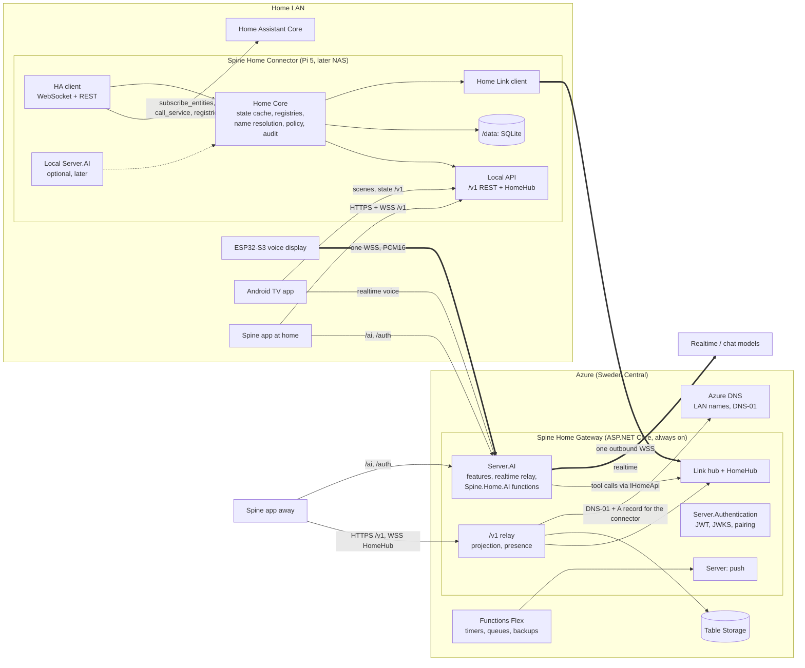

# Plan: Spine Home – a Home Assistant connector

**Started:** 2026-10-30
**Last updated:** 2026-10-30 (first draft from the research: system map, subsystems, decisions to review, spikes S1–S7 and phases 1–6)

A .NET 10 service at home, the **connector**, is the only thing that talks to Home Assistant (HA). It runs on a Raspberry Pi 5 first and on a NAS later. It owns the entity model, name resolution and the safety policy, serves a local `/v1` API with a live hub, and dials out to Azure over a single outbound connection. Through Azure, a Spine app, an ESP32-S3 voice display, an Android TV app and the Spine AI server reach the same `/v1` contract from anywhere. The app picks the local or the cloud path by itself and switches without the user noticing. Dashboards are built from HA entities and loaded by every client. The Spine AI server gets smart-home functions (list, search, read state, lights, blinds, climate, scenes, scripts) for text chat, realtime voice, the ESP display and the TV.

Working name: **Spine Home**. The HA-specific code lives in its own repository; what any Spine app could use becomes Maui.Spine issues (see [Spine gaps](#spine-gaps)). The full research behind this plan (HA's APIs, the Azure link, routing, Pi/NAS operation, AI tools and dashboards, and an inventory of the owner's private repositories) is kept outside this public repository.

Status values: **Proposal** (written, not reviewed), **Waiting** (on another step or an answer), **Ready**, **In progress**, **In review** (PR open), **Done**, **Parked**, **Dropped**.

---

## How to continue from a new session

1. Read this file. Check [Questions for the owner](#questions-for-the-owner): a step whose decision depends on an unanswered question is **Waiting**.
2. Spikes come before phases. Pick the first spike or step whose status is **Ready**.
3. Spine gaps are worked as Maui.Spine issues with `/spine-issue <id>`; connector, gateway and TV work happens in the Spine Home repository.
4. In the same PR that moves a step: set its status and PR here, add any decision to [Decisions](#decisions), and update **Last updated**.
5. Add what you could not verify to the [Verification backlog](#verification-backlog), and remove what you did verify.

---

## Principles

- **Only the connector touches Home Assistant.** Apps, the TV, the ESP display, the AI server and the cloud all speak the connector's `/v1` contract, directly on the LAN or through the gateway.
- **One contract, two transports.** The same REST paths, hub messages and sequence numbers locally and in the cloud. The cloud relays `/v1` unchanged; what only the cloud can do lives under `/cloud/*`.
- **The HA token never leaves home.** The cloud sends abstract commands (`commandId`, target, action, data); the connector maps them to HA with its own token and its own allow-list. A compromised cloud can never call `shell_command`, `hassio` or anything outside the list.
- **The path is chosen by an authenticated probe, never by the Wi-Fi name.**
- **Commands are absolute and idempotent** (`brightness_pct: 60`, not `toggle`), carry an `Idempotency-Key`, and are never queued while the home is offline: stale intent is dangerous for physical actions.
- **Spine stays a smorgasbord.** Generic parts (routing, a line chart, configurable controls) become Spine packages or issues; Microsoft.Extensions.AI remains the AI contract; no provider keys in apps.
- **Documentation is in English.** Conversation with the owner is in Swedish.

---

## System map

Thick arrows are long-lived single sockets; dotted ones are optional.

---

## Subsystems

| Subsystem | Responsibility | Technology | Runs on | Reuses |
|---|---|---|---|---|
| HA client (`Spine.Home.HomeAssistant`) | One multiplexed WebSocket to HA: auth, `supported_features` with coalescing, `subscribe_entities`, registries (incl. aliases via `get_entries`), `call_service` with `return_response`, history, statistics; REST for camera stills and health | `ClientWebSocket`, System.Text.Json source generators, Microsoft.Extensions.Resilience | Connector | Nothing ready-made; NetDaemon's source as reference |
| Home Core | State cache with `seq` and a ring buffer, registries and name resolution (name, alias, area, floor), exposure per caller class, protected entities, idempotent commands, audit | .NET 10, Microsoft.Data.Sqlite (WAL) | Connector | HA's intent design as the model |
| Local API | `/v1` REST, `HomeHub`, signed `GET /v1/hello`, local token exchange, `/health/live` and `/health/ready`, mDNS `_spine-connector._tcp` | ASP.NET Core Minimal API, SignalR (untyped hub, JSON), Kestrel with a Let's Encrypt certificate | Connector | – |
| Home Link | The one outbound connection: commands with results, state deltas, snapshots, heartbeat, the union of cloud subscriptions | SignalR client → gateway hub, behind `IHomeLink` | Both | – |
| Spine Home Gateway | Relays `/v1` unchanged, HomeHub for clients away, last-known-state projection and presence, pairing, DNS-01 for the connector, backup SAS | ASP.NET Core `net10.0`, Table Storage, Key Vault, Azure DNS | App Service B1 (Always On, WebSockets) or Container Apps with min one replica | Spine server hosting as in the Showcase |
| AI | Features (home chat, home voice, desk agent, TV agent), budgets per caller, realtime relay, the smart-home functions | `Plugin.Maui.Spine.Server.AI`, `Spine.Home.AI` with server-side `SpineAIFunction`s over `IHomeApi` | Gateway; optionally the connector | Server.AI unchanged |
| Identity and pairing | User sign-in, JWT/JWKS, device keys for the ESP display and the TV, connector enrolment with a one-time code | `Plugin.Maui.Spine.Server.Authentication`, private-key JWT for the connector | Gateway | Server.Authentication |
| Dashboards | Versioned schema, generator from areas/floors/labels/domains, storage with `rev` and ETag, cloud mirror | JSON in SQLite, C# generator | Connector (truth), gateway (mirror) | – |
| Client SDK (`Spine.Home.Client`) | `IHomeApi`, `IHomeEvents`, `IHomeRouter`, a routing `DelegatingHandler`, token choice | HttpClient, SignalR client, MAUI `Connectivity` | App (and the TV if it is .NET) | Spine's authentication handler; candidate for a Spine package |
| Spine app | Dashboards, controls, chat, voice, widgets and controls, push, settings | .NET MAUI with Spine packages | iOS, Android, Mac Catalyst | MasonryLayout, Reorder, Charts, ChatView, Voice, Widgets, PushNotifications, Rows |
| ESP32-S3 display | Wake word, echo cancellation, standing realtime session; later home context cards | ESP-IDF, ESP-SR | Desk | Existing desk-display firmware, unchanged in phase 3 |
| TV app | Scene rows, state, a voice button | Kotlin + Compose for TV (recommended) | Android TV / Google TV | The `/v1` contract |
| Background | Scheduled jobs, queue handlers, backups, retention | Functions Flex .NET 10 isolated, Spine Messaging | Azure | Spine Server, Messaging |
| Delivery and operation | One multi-arch OCI image, compose and a thin HA app wrapper, health, telemetry, update notices, backup | `aspnet:10.0-noble-chiseled-extra`, SDK container publish, GHCR, Azure Monitor OpenTelemetry, Diun or WUD | Pi 5, then NAS | Spine's Aspire sample |

---

## Key flows

- **App command at home.** `IHomeApi.LightSetAsync(...)` → router on `Local` (a signed hello probe confirmed the paired connector) → HTTPS to `connector.<installId>.home.<domain>:8443` with the user's JWT (validated offline against cached JWKS) or a local token → scope, allow-list, protection and idempotency checks → `call_service` on the connector's HA socket → `200`; the state change follows on HomeHub with a new `seq`.
- **App command away.** Same app code; router on `Cloud` → `api.<domain>/v1/...` → gateway authenticates, rate-limits, checks presence (`503 HomeOffline` with `lastSeen` if the home is offline) → `InvokeAsync` on the connector's link with a deadline → the connector runs the same code path → the response is returned unchanged. A Wi-Fi → cellular switch retries once on the other path with the same `Idempotency-Key`; live state switches make-before-break with `Subscribe(lastSeq)`.
- **Live state.** One `subscribe_entities` to HA, a monotonic `seq` per change and a ring buffer of ~1,000 events. Local clients subscribe with a filter; the connector forwards only the union of what active cloud clients watch, coalesced per entity (~250 ms for lights and covers, seconds with a dead band for sensors). After an HA restart the connector resubscribes and diffs the new snapshot against the old one.
- **ESP voice command.** The display's standing session over one WSS to the gateway's relay → the model calls `home_turn_on` → the relay runs the server function with the caller's context → `IHomeApi` over the link → the connector resolves the name (preferring the display's area), checks policy and calls HA → result back to the model → spoken answer. No firmware change: the relay already runs server functions for the device.
- **TV scene.** `POST /v1/scenes/{id}:activate` locally with the TV's device key; voice starts from the app's own button (the remote's assistant button belongs to the system) into a TV agent feature with a "no locks" scope and the living room as preferred area.
- **Dashboard load.** Render the cached version first → `GET /v1/dashboards/{id}` with `If-None-Match: <rev>` → `304` or new JSON → read the state of the dashboard's entities and subscribe from that `seq`. Cards whose entity disappeared are marked missing, never deleted.

---

## Decisions

All decisions are **Proposal** until the owner has reviewed them.

| # | Decision | Recommendation | Alternatives | Switch when |
|---|---|---|---|---|
| D1 | Home ↔ cloud transport | One outbound WSS to a self-hosted ASP.NET Core SignalR hub in the gateway: client results (`InvokeAsync<T>`) for commands, streamed deltas for state, behind `IHomeLink` | Web PubSub with Functions; Relay Hybrid Connections; Event Grid MQTT; Tailscale/Cloudflare Tunnel; IoT Hub | Functions-only becomes a hard requirement, or many homes must be carried (→ Web PubSub) |
| D2 | Cloud compute | An always-on gateway (App Service B1 or Container Apps) for everything with sockets or tight latency; Functions Flex for background work | Everything in Functions + Web PubSub | – (Functions caps HTTP at 230 s and cannot host Spine's realtime relay) |
| D3 | Where the AI relay and tools run | Server.AI in the gateway; tools as server `SpineAIFunction`s in `Spine.Home.AI` calling `IHomeApi`, with all logic in the connector | Server.AI in the connector; both | S2 shows p95 > 300 ms per tool call, or voice must survive an Azure outage (→ also host Server.AI in the connector) |
| D4 | MCP or in-process functions | In-process `SpineAIFunction`s for Spine's own sessions; an MCP facade over the same command API in phase 6 | MCP as the inner protocol; proxy HA's `/api/mcp` | Other agents (Claude, HA's MCP client) need the tools |
| D5 | HA client | Own thin client over `ClientWebSocket` with source-generated JSON | NetDaemon.Client (marked internal, no `subscribe_entities`); stale HADotNet/HassClient | – |
| D6 | Routing | `IHomeRouter`: authenticated hello probe, local at 0 ms and cloud at 250 ms, sticky with hysteresis, idempotency keys, make-before-break with `seq` | SSID matching; always cloud; VPN | – |
| D7 | Local TLS | A real host name per installation under an owned domain, Let's Encrypt via DNS-01 (records created by the gateway, so no DNS credentials on the edge), A record to the LAN IP; fallback: a pinned self-signed key distributed via the cloud | Private CA; plain HTTP on the LAN | S5 fails on the owner's router (DNS rebinding protection) |
| D8 | Authentication | Spine's JWT on both paths, validated offline with JWKS persisted on disk (~30 days last-known-good); a device-bound local credential from pairing; device keys for ESP and TV; HA token only in the connector | Separate local keys per client; HA tokens in clients | – |
| D9 | Dashboards | Own versioned schema; the connector is the truth (`rev`, ETag), the gateway keeps a readable mirror, clients cache; the default dashboard is generated from areas, floors and labels | Cloud as truth; render HA Lovelace directly | Several homes, or editing must work while the home is offline (→ cloud as truth) |
| D10 | Packaging | One multi-arch OCI image; compose first; a thin HA app wrapper if HA OS runs on the same Pi; the same image on the NAS | Only an HA app; systemd | – |
| D11 | Events into HA | `call_service` on scripts and automations with a non-admin HA user (`fire_event` and `subscribe_trigger` need admin) | Admin user; a companion integration | A need for custom events that scripts cannot cover |
| D12 | TV technology | Kotlin + Compose for TV as a leanback app with an optional HOME mode | .NET MAUI (no D-pad focus support) | S7 shows .NET for Android is enough |

---

## Spikes

| # | Spike | Question | Done when | Status |
|---|---|---|---|---|
| S1 | HA client | Does an own client handle `subscribe_entities`, registries with aliases, `call_service` with `return_response` and HA restarts on a Pi 5? | 24 h against a real HA and a demo container, incl. an HA restart, with no lost state; CPU and RAM measured | Ready |
| S2 | Link latency | What does a tool call gateway → connector → HA cost? | p50/p95 for `get_state` and `call_service` from Sweden Central measured against 150 ms / 300 ms | Waiting (S1) |
| S3 | HA tool on the ESP display | Does an HA tool work as a server function without a firmware change? | `scene_activate` and `home_get_state` listed in the desk agent feature on a gateway copy of the display's backend; function-to-speech time measured | Waiting (S2) |
| S4 | Swedish name resolution | Own tools vs HA's Assist MCP vs `conversation/process`; full vs mini realtime model | 50–100 household utterances with accuracy and latency per variant | Waiting (S1) |
| S5 | Local TLS | Do the owner's router, iPhone, Android (target 36 and 37), Mac Catalyst and the ESP display accept a Let's Encrypt name pointing to a LAN IP? | A green matrix, incl. the fallback when DNS rebinding protection blocks it | Waiting (Q5) |
| S6 | Routing | Can the client switch path mid-session without duplicate commands? | Wi-Fi → cellular with a command in flight and a live stream, no duplicates or gaps in `seq` | Waiting (S1) |
| S7 | TV microphone | Does a foreground app get audio from the remote's microphone on the owner's TV device, and can HOME be set? | Tested on the actual device; D12 decided | Waiting (Q6) |

The dev loop runs on the Mac with an Aspire AppHost: the connector, an HA container (`ghcr.io/home-assistant/home-assistant:stable`) with the `demo` integration, the gateway and Azurite. The same AppHost generates the Pi's compose file (`AddDockerComposeEnvironment`).

---

## Phases

| # | Phase | Content | Done when | Status |
|---|---|---|---|---|
| 1 | At home on the Pi 5 | `Spine.Home.Contracts` (DTOs, envelopes, OpenAPI, JSON contexts), HA client, Home Core, local API with a Let's Encrypt certificate, SQLite in `/data`, OCI image with compose or HA app, non-admin HA user; in the app a generated dashboard, controls and a settings page | The family controls the home from the app on the home Wi-Fi | Waiting (S1, S5) |
| 2 | Away | Gateway with sign-in, pairing, Home Link, `/v1` relay, HomeHub, projection and presence; the router in the client SDK; HA alerts to push via `IPushSender` | The same app works away with no settings, and an offline home shows "last seen" | Waiting (1, S2, S6) |
| 3 | AI | `Spine.Home.AI` in features for text chat (ChatView), app voice, the desk agent and the TV agent; protected entities with confirmation; budgets per caller | The ESP display and the app control the home by Swedish voice and text | Waiting (2, S3, S4) |
| 4 | Dashboards and surfaces | Editor with MasonryLayout and Reorder, cloud mirror, widgets and controls through generic slots, Live Activities, a line chart | A dashboard the user builds shows on every device | Waiting (2) |
| 5 | TV | Leanback app with scene rows, state and a voice button | Scenes and a voice chat from the sofa | Waiting (2, S7) |
| 6 | NAS and hardening | Move to the NAS with the same image and a restored `/data`, backup to Blob via SAS, Native AOT, signed commands, MCP facade, optional local relay, optional companion integration | Runs without the Pi, and external agents reach the same tools | Waiting (1–3) |

### The AI tool set (phase 3)

Twelve typed tools, modelled on HA's intent tools rather than a generic `call_service`: `home_list_devices`, `home_search`, `home_get_state`, `home_turn_on`, `home_turn_off`, `light_set` (brightness, colour name, kelvin), `cover_set_position`, `cover_stop`, `climate_set_temperature`, `scene_activate`, `script_run`, `media_control`.

- A target is `{name, area, floor, domain, device_class}`; a hidden `preferred_area` comes from the caller (the TV's room, the display's room).
- Results are `{ok, targets, failed: [{name, reason, candidates}], speech}`. Ambiguity returns candidates, never a guess.
- Name resolution in layers: exact case-folded name and alias, then Swedish normalisation (definite forms), then fuzzy matching.
- Locks, alarm panels, garage doors, valves and chosen scripts are **protected**: the first call returns `confirmation_required` with a short-lived token, and only a second call with it acts.
- Reads (temperature and the like) are answered from the connector's cache, so a voice tool call stays within the latency budget.
- A generic `call_service` belongs only in a separate admin API that is never given to the display or the TV.

---

## Spine gaps

To be filed as Maui.Spine issues when the phase that needs them starts.

| Gap | Needed in | Notes |
|---|---|---|
| A routing / connectivity service the packages' backend URIs can ask | 2 | Today each client package has a fixed `Backend` URI; v1 of the client SDK routes only `/v1` and leaves `/ai` and `/auth` on the cloud |
| `LineChart` and a widget sparkline | 4 | Charts has ring, bar and column only |
| Configurable widgets and controls (generic slots resolved at runtime) | 4 | An app has at most nine static controls and nine widget kinds |
| App Intents / Siri | later | Parked idea in Spine |
| A first TV head (D-pad focus) | 5, only if D12 changes | |
| A server-side MCP package | 6 | Only if the MCP facade turns out to be generic |

---

## Questions for the owner

| # | Question | Affects |
|---|---|---|
| Q1 | Where does HA run today: HA OS on the same Pi 5, other hardware, or HA Container? | D10 (HA app or compose) |
| Q2 | Is "Azure Function backend" a hard requirement, or is an always-on ASP.NET Core gateway (≈ B1) fine? | D1, D2 |
| Q3 | Only this home, or several homes / a product later? | Tenancy, D1, D9 |
| Q4 | Must voice or control work when the internet is down? | D3; a local-only voice path would mean an ESPHome variant against HA Assist |
| Q5 | Is there an own domain that can be moved to Azure DNS? | D7, S5 |
| Q6 | Does the TV launcher exist already: which device and which technology? | D12, S7 |
| Q7 | Which entities are sensitive, and may the AI ever unlock? | Protected entities, biometric step-up |
| Q8 | Dashboards per user or per home; is import from Lovelace needed? | D9, the schema, the editor |
| Q9 | Which realtime provider and region (Azure OpenAI Sweden Central, OpenAI, Gemini Live)? | Cost, data residency, latency |
| Q10 | Should the ESP display's backend move into the gateway, or get the Home Link itself? | Phase 3 |
| Q11 | Should HA scenes appear in Control Center / Quick Settings? | Spine gap: configurable controls |
| Q12 | What is the Spine Home repository called, and is it private? | Where phase 1 starts |

---

## Risks

| Risk | Counter-measure |
|---|---|
| HA changes undocumented WebSocket commands (`subscribe_entities`, registries, lovelace) | Integration tests against an HA container for every monthly release |
| HA's entity naming changes from 2026.11 (`friendly_name` deprecated) | Build display names from the registries and aliases |
| The gateway cold-starts | B1 with Always On, never F1; Functions only off the hot path |
| Tool latency over the WAN pushes voice answers past 1.5 s at p95 | S2, reads from cache, a persistent link, the local relay as retreat |
| The ESP display's internal RAM allows one TLS socket | Keep one socket; tools run server-side |
| The router blocks DNS rebinding | Connect to the cached IP while keeping the host name for TLS, pinning as fallback |
| iOS denies local network silently in the background; Android 17 needs `ACCESS_LOCAL_NETWORK` | Ask in the foreground during onboarding; a "no" means cloud only |
| Google TV does not let a third-party app be the home screen | A leanback app with an optional HOME mode where the device allows it |
| A compromised cloud or AI operates locks | Connector allow-list, protected entities, confirmation tokens |
| SD card wear | Boot the Pi from NVMe from the start |

---

## Verification backlog

- Official Azure prices for Sweden Central (the research could only read secondary sources).
- Whether Azure SignalR Service supports client results across several hub servers (only matters when scaling out).
- Whether the Web PubSub, Relay, Azure SignalR and MCP SDKs are AOT-clean.
- .NET 10 + SignalR footprint on a Pi 5 (S1 measures it).
- Whether HA's `/api/mcp` accepts long-lived tokens, whether `lovelace/dashboards/list` needs admin, and which user `SUPERVISOR_TOKEN` maps to (assume admin until proven otherwise; use a non-admin long-lived token in the HA app too).
- Remote-microphone capture and HOME mode on the owner's TV device (S7).
- Swedish quality of the realtime models (S4).
