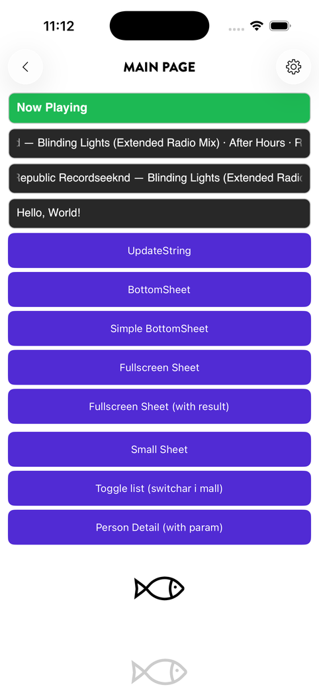

# AnimatedLabel

```bash
dotnet add package Plugin.Maui.Spine.Controls.AnimatedLabel
```

`Plugin.Maui.Spine.Controls.AnimatedLabel` provides a SkiaSharp-based label control that automatically scrolls (marquee) when the text is wider than the available space. It includes configurable scroll speed, pause duration, fade effects, text-change animations, and numbers that roll like an odometer.

<p align="center">
  
</p>
<p align="center"><sub>The two dark labels are AnimatedLabels; the text scrolls when it is wider than the label</sub></p>

---

## Platforms

| Platform | Status |
|---|---|
| Android | ✅ Supported |
| Windows (WinUI 3) | ✅ Supported |
| iOS | ✅ Supported |
| Mac Catalyst | ✅ Supported, exercised less than iOS |

---

## Registration

With `UseSpine()` nothing is needed: it registers the package, including the SkiaSharp renderers the control draws with. An app without Spine calls `UseAnimatedLabel()` in its `MauiProgram.cs` builder chain; calling it next to `UseSpine()` is harmless.

```csharp
using Plugin.Maui.Spine.Controls;

builder
    .UseMauiApp<App>()
    .UseAnimatedLabel();
```

---

## XAML usage

```xml
<AnimatedLabel
    Text="{Binding SongTitle}"
    TextColor="White"
    FontSize="16"
    FontFamily="OpenSans-Regular"
    ScrollSpeedDpPerSecond="40"
    PauseAtEndsMs="1500"
    HeightRequest="24" />
```

> Make sure `Plugin.Maui.Spine.Controls` is included in your global XAML namespace or add an explicit `xmlns` for the namespace.

---

## How it works

1. The label measures the text width against the control width.
2. If the text overflows by more than `ScrollThresholdDp`, a marquee animation starts automatically — the text scrolls from end to start and back, pausing at each end for `PauseAtEndsMs`.
3. When `EnableFadeOnTextChange` is `true`, the control cross-fades between the old and new text over `FadeDurationMs`.
4. Fade edges on the left and right mask text that is about to scroll in or out of view. The width of these edges is controlled by `FadeEdgeWidthDp`.

---

## Rolling numbers

With `Mode="RollingNumber"` the label is meant for a score, a count or a clock. When `Text` changes, the characters that differ roll vertically, like an odometer, and the rest stand still.

```xml
<AnimatedLabel Text="{Binding Score}" Mode="RollingNumber" FontSize="28" />
```

- **Which characters roll.** The characters are paired from the left, so `99` → `100` is 9 → 1, 9 → 0 and a new 0 that rolls in at the end, and nothing moves sideways. When both texts are built the same way, each group of digits is paired on its own: in `9:59` → `10:00` the colon does not roll, and in `9 pts` → `10 pts` the unit does not.
- **Which way.** When the number grows, the old digits leave upwards and the new ones come in from below. When it shrinks, as in a countdown, they roll the other way. The number is read with the app's culture, so `1,5` is one and a half in Swedish. A text that is not a plain number, like a time, compares its digits in order.
- **Tabular figures.** Every digit gets the width of the font's widest digit, so a number keeps its width while it counts and the digits beside a rolling one stay where they are. Other characters keep their own widths.
- **Alignment.** `HorizontalTextAlignment` places the number at the start, the centre or the end of the label. With `End` the characters are paired from the right instead, so the ones stay over the ones and a digit the number gains comes in at the front. With `Center` the number shifts half a digit when it gains one.
- **Reduce Motion.** With Reduce Motion (Remove animations on Android) turned on, the label fades as in `Marquee` mode, or changes at once if `EnableFadeOnTextChange` is `False`.
- **No marquee.** In this mode the text does not scroll sideways, since numbers are short. Text that is too wide is clipped.
- **Width.** The label fills the width it is given and draws the number in it, so something placed after the number (a unit, a trend arrow) does not follow the number's end on its own. The same is true of a number used as a [shared element](transitions.md#what-to-tag). In both cases, give the label a `WidthRequest` of its text's width, plus a little room in proportion to `FontSize` for glyph ink that reaches past the last digit. Widen it at once and narrow it only after `RollDurationMs`, so the wider value rolling away is not cut off. The label does not report its text's width, so measure the text as the label lays it out: every digit in a cell as wide as the widest digit, other characters at their own width.

A change that comes while a roll is still running starts a new roll from the latest value.

---

## Property reference

| Property | Type | Default | Description |
|---|---|---|---|
| `Text` | `string` | `null` | The text to display |
| `TextColor` | `Color` | `null` | Text colour |
| `FontSize` | `double` | `14` | Font size in scaled pixels |
| `FontFamily` | `string` | `null` | Font family name |
| `FontAttributes` | `FontAttributes` | `None` | Bold, italic, or both |
| `ScrollSpeedDpPerSecond` | `double` | `38` | Horizontal scroll speed (dp/s) |
| `PauseAtEndsMs` | `int` | `2000` | Pause duration at each end of the scroll (ms) |
| `FadeDurationMs` | `int` | `120` | Cross-fade duration on text change (ms) |
| `EnableScrolling` | `bool` | `true` | Enable or disable the marquee animation |
| `EnableFadeOnTextChange` | `bool` | `true` | Enable cross-fade when `Text` changes |
| `ResetOnTextUpdate` | `bool` | `true` | Reset scroll position when `Text` changes |
| `ScrollThresholdDp` | `double` | `2` | Minimum overflow (dp) before scrolling starts |
| `EndPaddingDp` | `double` | `2` | Extra padding at the end of the text before the scroll reverses |
| `FadeEdgeWidthDp` | `double` | `8` | Width of the left/right fade edges (dp) |
| `Mode` | `AnimatedLabelMode` | `Marquee` | `Marquee` scrolls and fades; `RollingNumber` rolls the characters that change |
| `HorizontalTextAlignment` | `TextAlignment` | `Start` | Where a text that fits is placed: `Start`, `Center` or `End`. A text that is too wide starts at the start |
| `RollDurationMs` | `int` | `350` | How long a change takes to roll in `RollingNumber` mode (ms) |

---

## Tips

- Set `EnableScrolling="False"` if you only want the fade-on-change effect without marquee scrolling.
- Use `ScrollSpeedDpPerSecond` and `PauseAtEndsMs` together to control the feel — a lower speed with a longer pause gives a gentler effect.
- The control renders via SkiaSharp (`SKCanvasView`), so it does not participate in the standard MAUI label layout. It sets its own `HeightRequest` from `FontSize` (`FontSize × 1.45 + 4`), again whenever the font changes, so a `HeightRequest` of your own does not last. It fills the width it is given.
