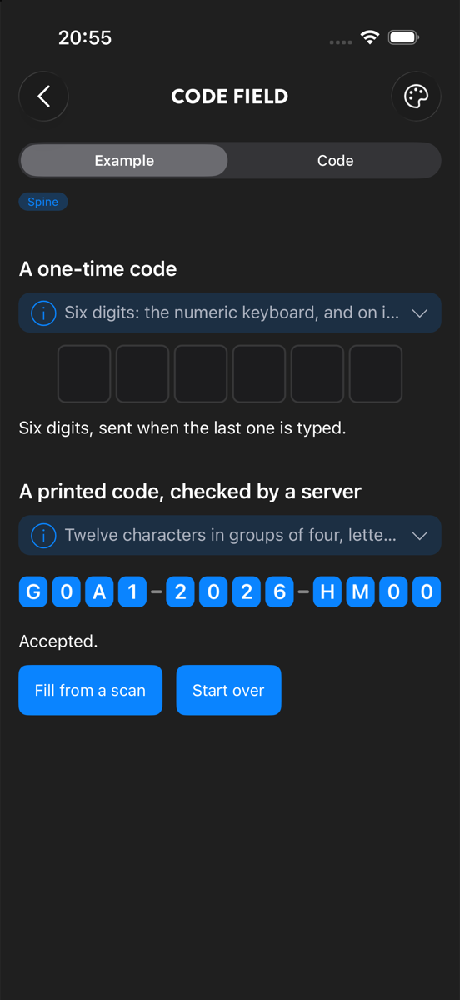

# Code field

`CodeField` takes a short code typed by hand: one cell per character, in groups with a dash between them, as the code is printed or sent. A one-time `482913`, an emailed `KMZG-HR4T`, a gift card's `HM7K-Q2X9-PD4M`. It is in the core package (`Plugin.Maui.Spine.Presentation`).

<p align="center">
  
</p>

```xml
<!-- Six digits: the numeric keyboard, and on iOS the one-time code from Messages or Mail above it. -->
<CodeField Code="{Binding Code}" CompletedCommand="{Binding VerifyCommand}" />

<!-- A printed code: letters and digits without the ones that are easy to misread, read as their twins. -->
<CodeField Length="12" GroupSize="4" Alphabet="0123456789ABCDEFGHJKMNPQRSTVWXYZ" Substitutions="O0 I1 L1"
           Code="{Binding Code}" State="{Binding CodeState}" IsActive="{Binding IsTyping}"
           CompletedCommand="{Binding RedeemCommand}" />
```

## Typing

- **One field underneath.** A hidden `Entry` owns the keyboard and the text, and the cells only draw it. So backspace, a hardware keyboard and the system's editing work as in any field, and VoiceOver and TalkBack read the code as one field.
- **Each character is mapped.** It is upper-cased and run through `Substitutions` (pairs separated by spaces). It is kept only if `Alphabet` has it, and a character that is not shakes its cell. Dashes and spaces are skipped, so a pasted `HM7K-Q2X9-PD4M` fills every cell.
- **A tap moves the caret.** The cell nearest the tap gets it, up to the first empty one. A character typed inside the code replaces the one under the caret, so a misread character is fixed with one tap and one key.
- **The keyboard.** An alphabet of digits only gets the numeric keyboard and, on iOS, `UITextContentType.OneTimeCode`. Any other alphabet gets the keyboard with capitals on.

## Sending and feedback

- **`CompletedCommand`** runs with the code when typing fills the last cell, or changes a character of a full code. A code set through `Code` from outside (a scan, a paste button, a link) fills the cells one after the other, 35 ms apart, and is not sent: whoever set it sends it.
- **`State`** is the app's to move, as the code is checked:

| State | The cells |
|---|---|
| `Editing` | Typed into; the cell with the caret has the accent edge and a blinking caret |
| `Checking` | Pulse, and take no typing; the keyboard goes down |
| `Accepted` | Light up in the accent from the left, with the success haptic |
| `Rejected` | The row shakes and the cells turn red, with the error haptic. They stay red until the app moves `State`, usually on the next edit |

  Reduce Motion keeps the colours and drops the pulse, the shake and the cells' pop.
- **`IsActive`** raises the keyboard when it becomes true, after 350 ms so a sheet sliding up can take it, and lowers it when it becomes false.

## Size and colours

- **Size.** A cell is at most 48 points wide, so six digits do not stretch across a tablet, and narrower where there is less room. Its height is about its width, and the character about two thirds of that. The row is centred.
- **Colours.** `AccentColor` comes from the app's `Accent` resource, or the system blue. `OnAccentColor` is black or white, whichever reads on the accent. `CellColor`, `TextColor` and `ErrorColor` have the system's grouped fill, label colour and red. `FontFamily` is the platform's bold by default. The control clears its own `BoxView` backgrounds, so an app's implicit `BoxView` style (the MAUI template has one) does not fill them.

## In Spine

The sign-in sheet takes the emailed code with it: eight characters, four and four, in the server's alphabet. It sends the code when the last cell is filled while the email is being verified. For a reset it waits for the new password.
