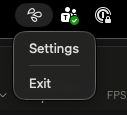

# Shortcuts

**Shortcuts** let users launch common app actions from outside the app: the menu on the app icon (Android, iOS), the jump list (Windows) and the tray menu (Windows, Mac). Each can have an icon, drawn from an SVG, and a subtitle.

---

## Concepts

| Term | Description |
|---|---|
| `SpineShortcut` | A record representing one shortcut: an `Id`, a `Title`, an optional `ShowInTray` flag, `Icon` and `Subtitle` |
| `IShortcutBuilder` | Fluent builder used at startup to declare shortcuts before the DI container is fully built |
| `IShortcutHandler` | Your handler class — declares shortcuts statically and handles invocations at runtime via DI |

---

## 1. Implement `IShortcutHandler`

Create a class that implements `IShortcutHandler`. The `Configure` method is `static abstract` so Spine can call it at startup without needing a DI-constructed instance:

```csharp
using MyApp.Pages.Settings;

namespace MyApp;

public class ShortcutHandler(INavigationService _navigation) : IShortcutHandler
{
    // Called once at startup — declare shortcut ids and labels here
    public static void Configure(IShortcutBuilder builder)
    {
        builder.Add(id: "settings", title: "Settings");
        builder.Add(id: "new-item", title: "New Item", showInTray: false);
    }

    // Called at runtime when the user activates a shortcut
    public Task InvokeAsync(string shortcutId) =>
        shortcutId switch
        {
            "settings" => _navigation.ShowAsync<SettingsPage>(),
            "new-item"  => _navigation.ShowAsync<NewItemPage>(),
            _           => Task.CompletedTask
        };
}
```

**Localized titles:** `Configure` runs inside `UseSpine`, before the app's [string documents](strings.md) are loaded, so `ISpineStrings` cannot look a title up there; it would return the key. Pass the key instead, `builder.Add(id: "settings", title: "Menu.Settings")`. Spine looks a title that is a key up when it builds the menu-bar or tray menu, and again when the culture changes. The last item, Quit, is `Spine.Tray.Quit`.

---

## 2. Register the handler in `MauiProgram.cs`

```csharp
builder.UseSpine(options =>
{
    options.AddAssembly(typeof(MauiProgram).Assembly);
    options.Shortcuts.UseHandler<ShortcutHandler>();
});
```

---

## 3. Icons and subtitles (optional)

```csharp
builder.Add(id: "scan", title: "Scan a code", icon: "qrcode", subtitle: "Opens the camera");
```

The home screen draws a shortcut's icon, not the app, so the icon has to be an image **inside the app**. iOS reads it from the app bundle and Android from its drawables. An SVG the app draws at run time is out of reach. Declare each icon to the build, and the build renders it into the app:

```xml
<ItemGroup>
  <SpineShortcutIcon Include="qrcode" />
  <SpineShortcutIcon Include="figure.run" />
</ItemGroup>
```

- The name is looked up among the app's own SVGs (`EmbeddedResource` and `MauiImage`) first, then in [Plugin.Maui.Spine.Svg.Icons](svg.md). Case is ignored and dots read as underscores, as with `W.Icon`: `qrcode` finds `QrCode.svg`, `figure.run` finds `figure_run.svg`. An app's own SVG replaces an icon of the set with the same name.
- The build adds each match as a `MauiImage` named `spine_shortcut_<name>`, which MAUI renders for every platform. The name in `Add(icon: …)` is mapped to it.
- A name with no SVG is a build warning.
- An icon named in `Add` but not declared: iOS shows the SF Symbol of that name if there is one (`star.fill`, `bolt`), otherwise its default dot; Android shows no icon. Both log a warning at startup.
- iOS draws the icon as a **template**, in the menu's own colour, so a single-colour SVG is what fits. Android shows it in the launcher's circle.
- The **subtitle** is a second line on iOS and the long label on Android, which the Pixel launcher does not show.
- The tray menus draw the same SVG at run time, as a template in the menu's colour, so they need only the embedded SVG, not the declaration.

---

## 4. Enable the tray icon on Windows and Mac (optional)

Shortcuts are also projected as tray menu items when the tray icon is on and the shortcut has `ShowInTray = true` (the default). On Windows that is the notification-area icon; on Mac Catalyst it is a status item in the menu bar. Both take an SVG for the icon (`TrayIconSvg`, rendered to `.ico` / `.png` by `Plugin.Maui.Spine.Svg`) and can keep the app running when its window closes:

```csharp
builder.UseSpine(options =>
{
    options.Shortcuts.UseHandler<ShortcutHandler>();

    options.Windows.ShowTrayIcon = true;
    options.Windows.TrayIconSvg = "logo.svg";
    options.Windows.TrayIconTooltip = "My App";
    options.Windows.CloseToBackground = true; // hide the window instead of exiting on close

    options.MacOS.ShowTrayIcon = true;
    options.MacOS.TrayIconSvg = "logo.svg";
    options.MacOS.CloseToBackground = true;
});
```

A shortcut declared with `showInTray: false` stays out of the menu but keeps its place in the jump list on Windows and the long-press menu on Android.

<p align="center">
  
</p>
<p align="center"><sub>The sample's tray menu on Mac Catalyst: the SVG status item, the <code>settings</code> shortcut, and Exit</sub></p>

---

## `IShortcutBuilder.Add` parameters

| Parameter | Type | Default | Description |
|---|---|---|---|
| `id` | `string` | — | Stable identifier routed to `InvokeAsync` |
| `title` | `string` | — | Human-readable label shown by the OS and in the tray menu |
| `showInTray` | `bool` | `true` | Whether to include this shortcut in the Windows tray context menu |
| `icon` | `string?` | `null` | An SVG by name (`qrcode`, `figure.run`); declare it with `<SpineShortcutIcon>` |
| `subtitle` | `string?` | `null` | A second line on iOS; the long label on Android |

---

## Platform behavior

| Platform | Where shortcuts appear |
|---|---|
| Android | App long-press menu (app shortcuts) |
| iOS | Home Screen quick actions: touch and hold the app icon |
| Windows | Jump list + tray context menu (when tray is enabled) |
| Mac Catalyst | Tray menu (when tray is enabled) |

---

## Keeping `Configure` side-effect-free

Because `Configure` is called before the DI container is ready, it must not access services or the database. Use only literal values for `id` and `title`.

Runtime navigation belongs in `InvokeAsync`, which is resolved from DI and has full access to injected services. Use `ShowAsync` rather than `NavigateToAsync` there: a shortcut used twice, or while its page is already open, then goes back to that page instead of stacking another copy (see [Showing a page from outside the app](regions.md#showing-a-page-from-outside-the-app)).
