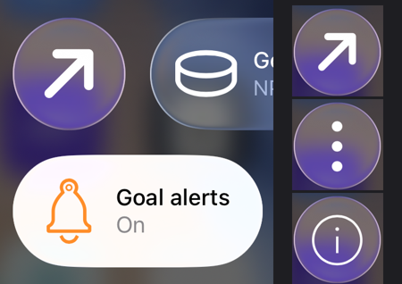

# Issue #743 — Widgets (iOS): spike a stroked SVG as a custom symbol for controls

**GitHub:** https://github.com/jonatansoderberg/Maui.Spine/issues/743
**Branch:** issue/743-widgets-ios-spike-a-stroked-svg-as-a-custom-symbol
**Status:** Completed (the spike says yes)

Step W0 of [docs/plans/widgets-everywhere.md](../docs/plans/widgets-everywhere.md) (decision D8). iOS draws only symbol images in a control (Control Center, the Lock Screen, the Action button). D3 drops SF Symbols, so Spine has to turn its SVGs and the app's into custom symbols in the widget extension. A custom symbol has to be filled shapes, and nearly all of Spine's 247 icons are strokes.

## Result

**Yes.** Spine's SVGs, stroked and filled, draw in Control Center as custom symbols, tinted like SF Symbols. Checked on the iPhone 17 Pro simulator (iOS 26.4, Xcode 26.2), with ArrowUpRight (stroke 6.5, round caps, a rotated group), Bell (the set's usual 2-wide strokes, in the orange Goal alerts toggle), More (true fills) and Info (fills and strokes mixed).

Not checked: a real iPhone, the Lock Screen and the Action button (same control, other hosts), and iOS 18.

## Plan

1. A small tool, `tools/SpineSymbols` (C#, SkiaSharp and Svg.Skia, as `WidgetIconAssets` uses): load an SVG, outline every stroke with `SKPaint.GetFillPath`, union everything, and write an SF Symbols template plus `Contents.json` as a `.symbolset`.
2. Find what template `actool` accepts by trying variants against it directly.
3. Compile a catalog into the extension: an optional `--assets` for `spine-widgets-build.sh` (actool into the `.appex`), set from a `SpineWidgetsAssetCatalog` property.
4. Let a control draw a custom symbol: `Image(name)` when the extension's catalog has one by that name, else `Image(systemName:)` as today.
5. In the Showcase: symbolsets for the four icons; Goal alerts on `Bell`; a new "Spine icons" button that steps through all four.
6. Build for the iPhone 17 Pro simulator, add the controls to Control Center, and check shape and tint.

## Open Questions

## Changes

- `tools/SpineSymbols/` (`spine-symbols <catalog.xcassets> <icon.svg>...`): `SymbolOutline` walks Svg.Skia's drawing commands (`SKSvg.Model`) with their matrices, outlines strokes with each stroke's own width, cap, join and dash, keeps fills, skips invisible paint (`fill-opacity="0"`, `stroke-width="0"`), unions with `SKPath.Op` and turns the result to non-zero winding; `SymbolTemplate` writes the template; `Program` writes one `.symbolset` per SVG, named after the file.
- `spine-widgets-build.sh`: `--assets <dir>` compiles an asset catalog into the extension with actool (iOS only; the Mac build has no controls and says it leaves the catalog out).
- `Plugin.Maui.Spine.Widgets.targets`: `SpineWidgetsAssetCatalog` passes it, tracks its files as inputs, and takes the catalog out of the app's own `ImageAsset` items (the SDK globs every `*.xcassets` in the project into the app's catalog).
- `SpineControls.swift`: `ControlSymbols.image` draws a custom symbol from the extension's catalog when there is one by that name (with or without `.svg`), else the SF Symbol as before.
- Showcase: `Platforms/iOS/SpineWidgets.xcassets` (four symbolsets written by the tool), `SpineIconsControl` ("Spine icons"), Goal alerts on `Bell`.

## Decisions

### What the template must be (actool and SpringBoard, Xcode 26.2, iOS 26.4)

Found by compiling variants with actool and checking `assetutil --info`, then in Control Center:

- **Guides:** all six of `Baseline-S`, `Capline-S`, `Baseline-M`, `Capline-M`, `Baseline-L`, `Capline-L` (`<line id="…">`). Without any one, actool fails ("missing a baseline guide for Baseline-M", "missing a capline guide for Capline-S").
- **Margins:** `left-margin-<glyph>` and `right-margin-<glyph>` lines; without them: "interpolatable margins on Ultralight-S, Regular-S, and Black-S, or fixed margins on Regular-M or Regular-S are required".
- **Glyphs:** either `Regular-M` alone (static) or `Ultralight-S` + `Regular-S` + `Black-S` (variable). `Regular-S` alone is refused: "must have a glyph for Regular weight Medium size".
- **Only the variable form draws in a control.** A static `Regular-M` symbol compiles, the extension finds it (`UIImage(named:)`), and so does any other process (UIKit and SwiftUI `Image(_:bundle:)` from a simulator command-line tool), but SpringBoard, which draws the control, logs `No image named 'ArrowUpRight' found in asset catalog for …/SpineWidgets.appex` and the control stays empty. That held after rebooting the simulator, with a 3.0 template, with `symbol-rendering-intent: hierarchical`, and with `Label(_:image:)`. The variable form with the same outline at all three weights drew at once.
- **Template version:** read from `<g id="Notes"><text id="template-version">Template v.3.0</text></g>`; without it `assetutil` reports Template Version 0. The generator writes 3.0 and the paths' rendering classes (`monochrome-0 multicolor-0:tintColor hierarchical-0:primary`). Whether a control needs them as well as the variable glyphs was not isolated; they cost nothing.
- **Not needed:** the rest of Apple's Notes artboard, the `H-reference` glyph, `symbol-rendering-intent` in `Contents.json`.
- **Names are case-sensitive** in an asset catalog: `UIImage(named: "bell")` does not find `Bell`. The SF Symbol `bell` is then drawn, which is what the Goal alerts toggle showed until its state said `Bell`.

### Other choices

- **One outline at three weights.** The variable template needs glyphs that interpolate point for point; the same outline three times does, trivially, so the symbol draws alike at every weight. Outlining strokes at three widths would give real weights, but unioned outlines of different widths rarely have matching points. Left for W11 if wanted.
- **Size.** The icon's 50-unit viewBox is drawn 120 units tall (SF Pro's cap height at 100 pt is 70.459), centred on the middle of the capitals. Spine's icons leave about a fifth of the box empty, so Bell and Info come out about as large as SF's `bell` and `info.circle` beside them; 88 was two thirds of that. Spine's thin strokes stay thin: Bell reads lighter than SF's `bell`.
- **An image by value does not work.** `Image(uiImage:)` of the symbol draws the system's dashed question-mark placeholder: a control takes only a named symbol, which SpringBoard looks up itself.
- **Name lookup in Swift.** `UIImage(named:)` decides custom versus system, so SF Symbol names keep working until W11 removes them, and a name may carry `.svg` as `SpineIcons.*` does.
- **The catalog is checked in** for the spike, written by the tool. W11 generates it at build time from the names the app's controls use.

### Seen on the way, not part of W0

- The app's refresh at launch rewrote only `goal.json` in the simulator; `goal-alerts.json` kept a state from two days before (`bell`), and taps on the "Spine icons" button did not step it to the next icon (whether `OnActionAsync` ran was not traced). The states were written by hand into the App Group to check each symbol; a tap then redrew the control from them. Worth a look in W11, which touches the same path.
